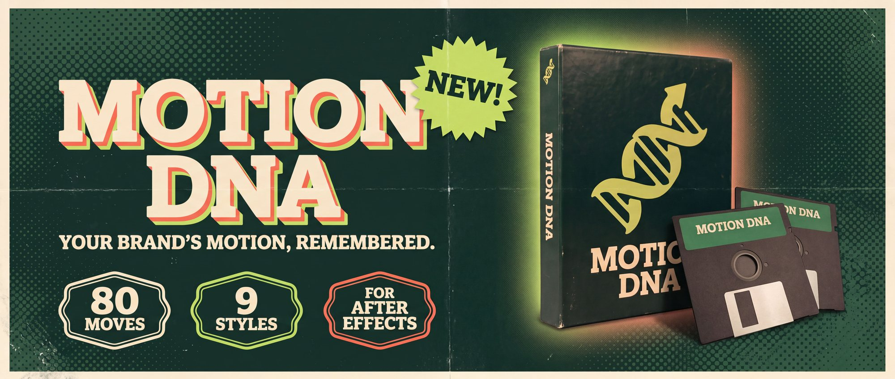
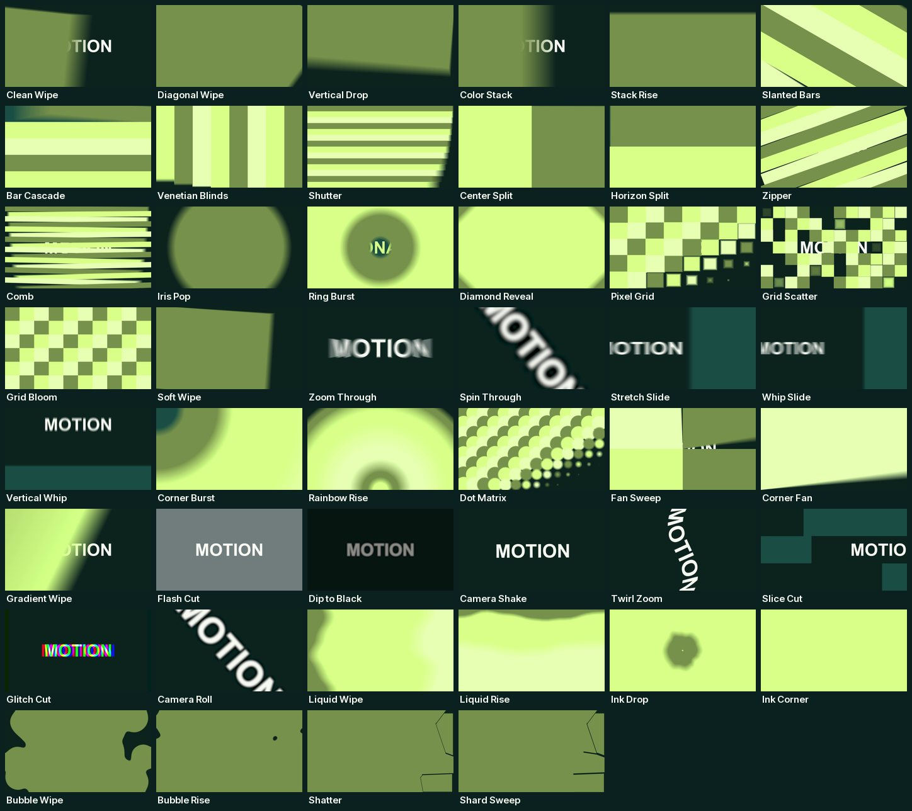
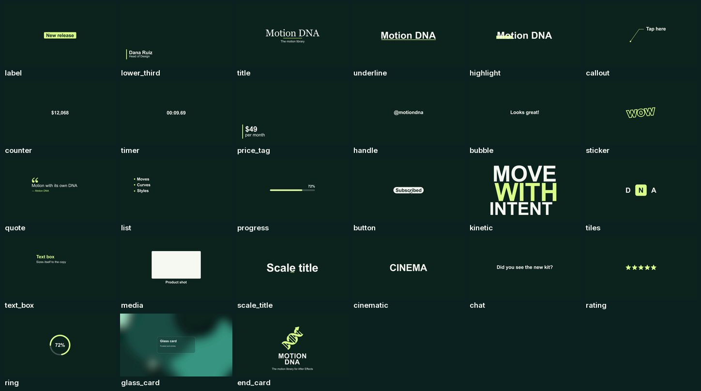
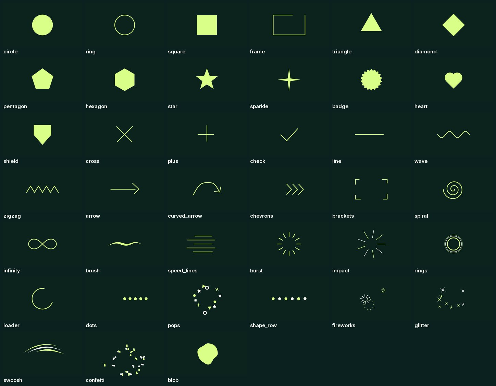
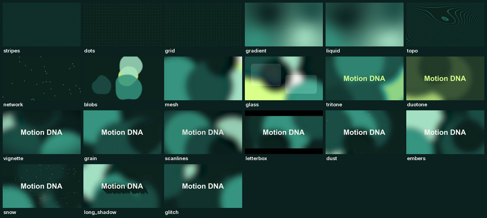
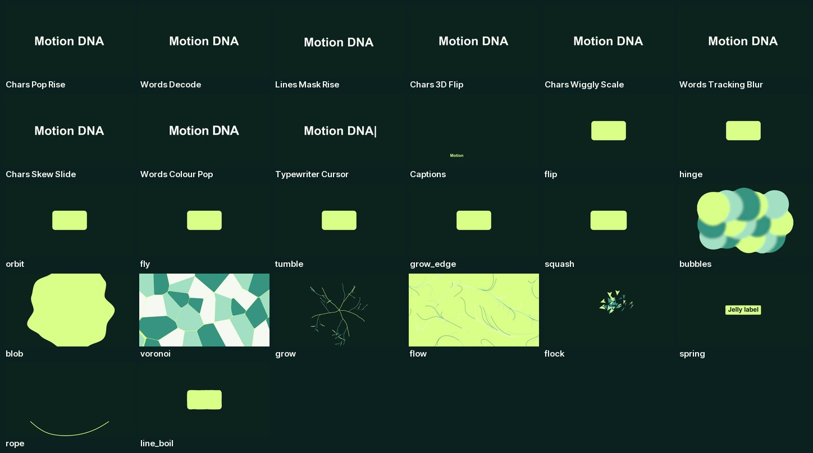
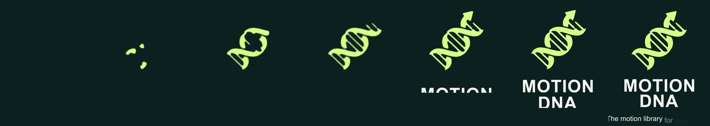

# Motion DNA

Motion made with AI all looks the same: same curves, same moves, same templates. **Motion DNA** gives it an identity.
It is a motion library for After Effects (80 moves, 14 curves, 9 styles, 12 techniques and a kit of 159 pieces Claude builds for you, built on measured references)
with a panel for designers and an AI agent that works inside After Effects. You direct; it accelerates. Every brand you
animate keeps a profile that **learns from each review**, and everything it makes is native keyframes.

**What you get**
- **Your motion, not the default.** Pick moves and curves by feel (energy 1 calm → 5 explosive, tone), hover to see
  them move, apply them to the selected layers. Already animated? Keep your keyframes and change only their timing and
  curve.
- **Brands that learn.** Each review note becomes a rule of that brand; the next order, the next video and the next
  person start from everything it learned. Share a brand with one file.
- **An agent that knows the library.** Ask in plain words ("animate these Figma frames in the Editorial style"); it uses
  the library, the brand and your selection, and shows what each order cost.
- **Claude where you prefer.** The same conversation continues in the panel, the Claude app or a terminal: one per brand
  and one per video.
- **A kit Claude builds for you.** 159 semi-finished pieces (transitions, titles and callouts, shapes, organic
  backgrounds, looks, text animations, 3D moves and behaviours) that size themselves to your text, take the brand's
  colours and move on the same token curves. Pick one in *Agent › Library › Kit* or ask for it by name.

 

## What's new

- **The kit: 159 pieces, all on the token curves** ([see them](#the-kit-everything-claude-can-build-by-category), every
  one with a preview in [docs/CATALOG.md](docs/CATALOG.md)): 46 transitions (34 from solids and masks, 12 clip to clip),
  27 self-sizing elements, 39 animated shapes, 10 backgrounds, 11 finishing looks, 10 text animations, 7 3D moves and
  9 behaviours. Rebuilt by behavior from what Animation Composer ships, compared side by side and kept only when they
  looked as good or better ([the map](docs/animation-composer-map.md)).
- **Organic motion:** a plexus `network` (points joined by lines that fade with distance), breathing `blobs`, a `mesh`
  gradient and frosted `glass` backgrounds, a smoky `glass_card`, and `liquid` and `ink` transitions with living edges.
- **Behaviours:** the algorithm apart from what it draws. `bubbles`, `voronoi`, `flow`, `flock`, `spring`, `rope`,
  `grow` and the hand-drawn `line_boil`, each drawn into a shape, a background, a text matte, an element's box or a
  transition (`add_behavior`). Every one carries its review verdict: where it works, where it was dropped and why.
- **In the panel:** *Agent › Library* has a **Kit** tab next to Styles and Techniques, with a preview and a ready order
  for each piece.
- **Our logo, built stroke by stroke:** the helix mark, cleaned into vectors and split into its pieces, assembles
  itself (strands, then rungs, then the arrow, with granular edges), then MOTION / DNA rise below it. The new
  *Stroke build* technique works for any filled logo; the logo manual is in Figma.
- **Keyframe tools** like Animation Composer's helpers: ease every key with a token, copy an ease, reverse, mirror an
  entrance into an exit, stagger, randomize, sequence, distribute, loop, bake, and a 9-point anchor mover (`keyframes`,
  `anchor_point`).
- **Outside resources, license checked:** 166 scripts, expression libraries, VFX, sound effects and music tracks
  (`list_resources`); `python tools/fetch_free_assets.py` downloads the CC0 packs Claude can drop in (`add_asset`).

## Get started

1. **Install** (Windows or macOS): double-click `INSTALL-Windows.cmd` / `INSTALL-macOS.command`, or run
   `python tools/setup.py` (or ask Claude to install Motion DNA). The panel is signed on your machine: no Adobe
   developer mode, no admin rights.
2. **Open After Effects** › **Window › Extensions › Motion DNA** (also *File › Scripts › Motion DNA*) and dock it once:
   it comes back every time. The link with Claude starts with After Effects by itself.
3. **Agent › Connect:** *Connect Claude* (sign in once) and, if you use Figma, *Connect Figma* (press Allow).
4. Once, in After Effects: *Preferences › Scripting & Expressions › Allow Scripts to Write Files and Access Network*.

Update with `python tools/setup.py --update` (never over your local changes) · remove with `--uninstall`.

Install details: signing, developer mode, the classic panel, where things live

- `setup.py` signs the panel (`panel/`, a CEP extension) on your machine with a self-signed certificate made with
  Adobe's ZXPSignCmd (downloaded once into `tools/.cache/`) and installs the signed copy, so After Effects loads it with
  no developer mode. The installed copy is a shell that loads the panel's code from your clone: after `git pull`, close
  and reopen the panel.
- It also installs *File › Scripts › Motion DNA* (opens the panel) and a silent Startup script (starts the Claude bridge
  when After Effects opens), and removes entries older versions left. Fonts (Inter Tight, Instrument Serif, OFL) and the
  local asset-pack previews come with it.
- Developers: `python tools/setup.py --dev` runs the panel straight from the clone (edits show with **F5**); that needs
  Adobe's developer mode, and setup asks before turning it on (only you can say yes).
- The previous ScriptUI panel (`tools/ss_panel.jsx`) opens instead when the HTML panel is missing.
- Brands: templates in `library/brands/` (Motion DNA, the 22 rules learned making our promo); yours in
  `library/brands.local/` or a folder you choose. Terminal: `python tools/brand.py new | note | show | export | import`.
  Schema: [`library/brands/_schema.md`](library/brands/_schema.md).

## Use it

> **Manual:** [docs/USER_GUIDE.md](docs/USER_GUIDE.md) explains every part step by step, with tips by industry and a
> section for Claude. [docs/use-cases](docs/use-cases/README.md) has the tests behind it: each tool on a real-looking
> piece (fashion, eyewear, beauty, kitchen, cars), what broke, and how it was fixed.

### Connect Claude and Figma

*Agent › Connect* has one button each. **Connect Claude** opens the sign-in (your Claude account) and turns green by
itself. **Connect Figma** opens Figma's own permission page: press Allow. The header shows **MCP · Claude · Figma**:
green is ready, a click opens Connect. When Figma asks for permission again, the same button reconnects it.

 

### Animate the selected layers: create, or modify what is there

**Behaviors**: choose a type (Moves, Classics, Text, Loops, Transitions, Recipes, Favorites), hover a preset to see it
move, tune *Duration · Intensity · Direction · Easing* and press the button, which says what it will do:
- **Create** when the layers have no keyframes;
- **Modify** when they already move: your keyframes and values stay, they get the preset's timing and curve;
- **Replace** to swap their animation for the preset on the channels it uses (a rotation it does not touch stays);
- **Transition** with two layers selected in *Transitions*: the first leaves as the second arrives.

**Remove** cleans off what Motion DNA added. With *Marker timing*, drag the `SS in` / `SS out` markers to retime.

 

### Shape the curve

**Curves**: the editor starts on the S curve `(1, 0, 0, 1)`. Drag the handles, type `x1, y1, x2, y2`, or pick a
library curve (the active brand's own curves come first). **Apply to keyframes** eases the selected keyframes; with none
selected, every keyframe of the selected layers. Values never change, only speed. **Read keys** loads a curve from your animation, **Save curve** adds yours to the library
or to the brand.

 

### Styles, techniques and the kit, ready to ask for

*Agent › Library* shows the **Styles** (a whole comp, role by role), the **Techniques** (tracked labels, text behind
people, roto, speed ramps, HUD, stroke build…) and the **Kit** (transitions, elements, shapes, backgrounds, looks, text,
moves and behaviours) with a preview, what each one does and a ready order: **Use in chat** sends it to the
agent, **Copy order** takes it to Claude Code. Layers that already move keep their animation.

 

### A brand learns from every review

Tell the agent what to fix ("the car bounces, make it glide"): it fixes it and proposes the note as a **rule**. One
click keeps it in the **brand**, the **project** (only this video) or the **general** rules. *Brands › Rules* lists them
to add, edit or remove. From then on every order for that brand starts from them, in the panel and in Claude Code.

 

### Share a brand, and know where it lives

*Brands › brand › Overview* says **where it lives** (its folder, with *Open folder*). **Download to share** writes one
file (`<brand>.motiondna-brand.json`); the other person presses **Import brand file**, and if they already have the
brand, new, edited and removed rules merge into theirs and show as *new*. Client brands never go in this repo (only
templates do); conversations stay on each computer.

 

### One conversation per brand and per video

A brand has its own folder and its own Claude conversation for everything about it (*Brands › Claude › Start in Claude
app* puts it in the Claude app's sidebar). Each video is a **project** inside the brand folder (*Agent › Project*:
brief, references, footage, audio, AE, renders, exports), with its own conversation and rules. Continue any of them
from the panel, the Claude app or a terminal (*Copy terminal command*, or `>_` in the chat); the panel warns if it is
open somewhere else.

 

### Claude Code and other agents
Open the repo (or a brand or project folder) in Claude Code and approve the `motion-dna` server. Its tools:

| To… | Tools |
|---|---|
| Browse | `list_presets` · `list_packs` · `list_tags` · `suggest_mix` · `match_reference` · `list_brands` · `get_brand` · `list_assets` · `list_resources` (outside scripts, VFX, SFX and music, license checked) |
| Act in After Effects | `apply_preset` · `apply_pack` · `apply_brand` (`existing` = modify / replace) · `apply_transition` · `add_asset` · `remove_animation` |
| Build what AC packs ship (by behavior, on our tokens) | `solid_transition` (46 named looks: solid/mask wipes, iris, fan, dots, liquid, ink, bubbles, shatter, flash, glitch, twirl, slices…) · `add_element` (27 self-sizing kinds: titles, callouts, counters, timers, social, quotes, lists, chat, rating, cinematic, glass card, our logo end card…) · `add_shape` (39 animated shapes, lines, impacts, fireworks, glitter…) · `move` (3D flip, hinge, orbit, fly…) · `animate_text` (per char/word/line, decode, mask, typewriter) · `add_captions` · `add_look` (backgrounds incl. plexus, blobs, mesh and frosted glass, tones, grain, letterbox, particles, long shadow, glitch) · `add_behavior` (9 behaviours by family, each drawn into shapes, backgrounds, text mattes, element boxes or transitions: bubbles, blob, voronoi, grow, flow, flock, spring, rope, and the hand-drawn `line_boil`) · `list_kit` |
| Edit keyframes | `keyframes` (reverse, mirror_out, stagger, shift, to_playhead, sequence, distribute, loop, bake, stretch, copy_to) · `anchor_point` |
| Run techniques | `matte` (a cut-out on the local GPU) · `text_behind` |
| Learn and check | `add_brand_note` · `ae_status` · `list_layers` · `render_frame` · `check_layout` |

The order of work and recipes that worked: [User guide › For Claude](docs/USER_GUIDE.md#for-claude). Without MCP, any
LLM reads `library/INDEX.txt` and runs `.jsx` jobs with `bash tools/bridge.sh`.

**Background resources for Claude** (not in the panel):
- `library/resources.json` catalogs 166 outside scripts, expression libraries, VFX, sound effects and music. Each entry has its license checked, whether it needs credit, and whether it can live in the repo.
- `python tools/fetch_free_assets.py` downloads the free CC0 packs (fire, smoke and explosion sequences, particles, SFX, jingles, music tracks) into `assets.free/`.
- `vendor/` holds small open-source code (json2, eKeys, aefunctions) with its licenses.
- Behavior maps: [Animation Composer](docs/animation-composer-map.md) and [paid AE tools vs open source](docs/ae-tools-map.md).

## Tested on real work

Every tool, technique and style was run on a small, realistic piece from five industries, with fictional brands. Each case says which part of
Motion DNA it tests, shows the result, and leaves a tip. What broke and how it was fixed:
[docs/use-cases](docs/use-cases/README.md). The manual built from it: [docs/USER_GUIDE.md](docs/USER_GUIDE.md).

| Case | Tests | Result | Tip |
|---|---|---|---|
| **UC01** · Fashion | Behaviors › Moves · Create |  | Select the layers in reading order: the stagger follows it. |
| **UC02** · Eyewear | Behaviors › Modify / Replace |  | A client file that already moves: Modify keeps its poses. |
| **UC03** · Beauty | Behaviors › Text |  | Put text where the texture is calm, or on a card. |
| **UC04** · Kitchen | Behaviors › Loops and Transitions |  | Select both layers and press Transition: the cut is one move. |
| **UC05** · Cars | Curves |  | "Smoother, more premium" = same keys, S curve or Coast. |
| **UC06** · Beauty | Brands |  | Write rules anyone could follow; share the brand as one file. |
| **UC06b** · Beauty | Agent › Chat: a review note becomes a rule |  | Keep each rule where it belongs: brand, project or general. |
| **UC07** · Fashion | Agent › Library › Styles |  | No layers selected means the whole comp. |
| **UC08** · Fashion | Agent › Library › Techniques (text behind) |  | Cut-outs with `matte` / `text_behind`; watch the contrast. |
| **UC09** · Cars | Agent (Full): Figma → After Effects, brand timing |  | Put numbers in the brand's timing: `apply_brand` follows them. |
| **UC10** · All | Agent › Project |  | Keep the `.aep` in the project's `05_ae`. |
| **UC11** · All | Claude Code (MCP: every tool, 27/27) + layout QA |  | Before calling it done: `render_frame`, then `check_layout`. |
| **UC12** · Cars | Technique: tracked labels + HUD |  | On a moving shot, point callouts inward and give them a card on light plates. |
| **UC13** · Cars | Technique: speed ramp |  | Give the ramp a plate 2.5× longer than the rushed part. |
| **UC14** · Eyewear | All 9 styles on one layout |  | Parent a button's label to the button: styles move them together. |
| **UC15** · Fashion | Techniques: text behind (video), contour, roto breakdown |  | `matte` the plate, then `behind` + `contour` in one scene spec. |
| **UC16** · Fashion | Technique: freeze frame + kinetic type |  | Split the title around the person, in the empty space. |
| **UC17** · Kitchen | Technique: shape wipe |  | A title that would touch the product breaks into two lines and two sizes. |
| **UC18** · Beauty | Technique: marker timing |  | Drag `SS in` to retime without touching a key. |
| **UC19** · Cars | Technique: cut on the voice |  | Cut two frames before each phrase; check brand names in the transcript. |
| **UC20** · Eyewear | Brands: a style that learns (v1 → v3) |  | Each review note becomes a rule; numbers go in the brand's timing. |

## The library

| Moves | Classics | Text | Loops | Recipes | Styles | Techniques | Curves | Kit |
|---|---|---|---|---|---|---|---|---|
| 32 | 17 | 11 | 11 | 9 | 9 | 12 | 14 + 6 durations | 159 |

Full catalog with live thumbnails, kit included: **[docs/CATALOG.md](docs/CATALOG.md)** · filterable: `library/index.html` · for LLMs:
`library/INDEX.txt` · tags: `library/tags.json`. All timing comes from the motion tokens: presets ask for `Arrive` +
`Land`, never a raw speed, so the whole library retunes in one place.

### The kit: everything Claude can build, by category

Besides presets, styles and techniques, Claude builds these pieces on the open comp through the MCP server. They are
semi-finished like Animation Composer's: they size themselves to the text, take brand colours and fonts, and every
movement uses the token curves (acceleration and deceleration, overshoot when the energy asks for it). Browse them in
the panel (*Agent › Library › Kit*, with a ready order), in `docs/CATALOG.md` or `library/index.html`, and ask for them by name in the chat. The full list with energy and tones is `library/kit.json`
(`list_kit`); transition looks are in `library/transitions.json`.

| Category | Ask for… | Tool |
|---|---|---|
| **Solid transitions** (34 looks; colour layers and masks, one controller) | `Clean Wipe`, `Diagonal Wipe`, `Vertical Drop`, `Color Stack`, `Stack Rise`, `Slanted Bars`, `Bar Cascade`, `Venetian Blinds`, `Shutter`, `Center Split`, `Horizon Split`, `Zipper`, `Comb`, `Iris Pop`, `Ring Burst`, `Diamond Reveal`, `Pixel Grid`, `Grid Scatter`, `Grid Bloom`, `Soft Wipe`, `Corner Burst`, `Rainbow Rise`, `Dot Matrix`, `Fan Sweep`, `Corner Fan`, `Gradient Wipe`, `Liquid Wipe`, `Liquid Rise`, `Ink Drop`, `Ink Corner`, `Bubble Wipe`, `Bubble Rise`, `Shatter`, `Shard Sweep` | `solid_transition` |
| **Clip transitions** (12; shot to shot) | `Zoom Through`, `Spin Through`, `Stretch Slide`, `Whip Slide`, `Vertical Whip`, `Flash Cut`, `Dip to Black`, `Camera Shake`, `Twirl Zoom`, `Slice Cut`, `Glitch Cut`, `Camera Roll` | `solid_transition` |
| **Elements** (self-sizing graphics) | `label`, `lower_third`, `title`, `underline`, `highlight`, `callout`, `counter`, `timer`, `price_tag`, `handle`, `bubble`, `sticker`, `quote`, `list`, `progress`, `button`, `kinetic`, `tiles`, `text_box`, `media`, `scale_title`, `cinematic`, `chat`, `rating`, `ring`, `glass_card`, `end_card` (our logo close) | `add_element` |
| **Shapes** (draw on, hold, leave) | `circle`, `ring`, `square`, `frame`, `triangle`, `diamond`, `pentagon`, `hexagon`, `star`, `sparkle`, `badge`, `heart`, `shield`, `cross`, `plus`, `check`, `line`, `wave`, `zigzag`, `arrow`, `curved_arrow`, `chevrons`, `brackets`, `spiral`, `infinity`, `brush`, `speed_lines`, `burst`, `impact`, `rings`, `loader`, `dots`, `pops`, `shape_row`, `fireworks`, `glitter`, `swoosh`, `confetti`, `blob` | `add_shape` |
| **Backgrounds** (looping, brand colours) | `stripes`, `dots`, `grid`, `gradient`, `liquid`, `topo`, `network`, `blobs`, `mesh`, `glass` | `add_look` |
| **Behaviours** (the algorithm apart from what it draws; by family) | **fill** `bubbles` (metaballs that merge), `blob`, `voronoi` (cells, shards), `grow` (vines) · **swarm** `flow` (noise flow field), `flock` · **physics** `spring` (jelly box), `rope` (verlet) · **modifier** `line_boil` (hand-drawn tremble on 3s, any layer; the Collage style applies it). Targets: `shape`, `background`, `text` / `mask`, `box` (an element's box), `transition`, `layer` | `add_behavior` |
| **Looks** (finishing layers) | `tritone`, `duotone`, `vignette`, `grain`, `scanlines`, `letterbox`, `dust`, `embers`, `snow`, `long_shadow`, `glitch` | `add_look` |
| **Text engine** (per char, word or line) | `Chars Pop Rise`, `Words Decode`, `Lines Mask Rise`, `Chars 3D Flip`, `Chars Wiggly Scale`, `Words Tracking Blur`, `Chars Skew Slide`, `Words Colour Pop`, `Typewriter Cursor`, `Captions`; channels fade, rise, drop, slide, scale, rotate, 3D, skew, tracking, blur, decode, colour | `animate_text`, `add_captions` |
| **Moves** (2D/3D entrances and exits) | `flip`, `hinge`, `orbit`, `fly`, `tumble`, `grow_edge`, `squash` | `move` |
| **Keyframe tools** | `ease`, `copy_ease`, `reverse`, `mirror_out`, `stagger`, `randomize`, `shift`, `to_playhead`, `sequence`, `distribute`, `loop`, `copy_to`, `bake`, `stretch`, anchor point (9 positions) | `keyframes`, `anchor_point` |
| **Resources** (outside, licensed) | CC0 SFX, music, VFX sequences, textures, open-source scripts | `list_resources`, `add_asset` |

**Our logo** (the helix mark and its MOTION / DNA lockups) lives in `assets/brand/` and in the Figma file [Motion DNA — Logo & Library](https://www.figma.com/design/oFm28esz50v8d5Cxn54ytA), with its manual (lockups, colours, clear space, misuse, how it moves) and the library overview. Every Motion DNA demo closes on it: `add_element(kind="end_card")` builds the mark piece by piece (the *Stroke build* technique), then MOTION / DNA rise under it.

Example: *"Open on a `mesh` background, a `glass_card` with the title, `Ink Drop` into the plexus (`network`) scene, and
finish with `grain`."*

**Transitions** (`solid_transition`): colour layers and masks over a cut, one controller (Progress, Direction, Stagger,
Ease In / Out, Color 1–3; one colour gives tonal shades), or clip to clip.

**Elements** (`add_element`): they measure their text and grow with it; Reveal, Padding, Radius, Gap and colours live on
one controller.

**Shapes** (`add_shape`): primitives, lines that draw on and travel off, and families (impacts, pops, fireworks,
glitter, swooshes, confetti, rings).

**Backgrounds and looks** (`add_look`): looping procedural backgrounds in brand colours, and finishing layers.

**Text, moves and behaviours** (`animate_text`, `add_captions`, `move`, `add_behavior`).

**The logo close** (`add_element(kind="end_card")`, technique *Stroke build*): each piece of the mark is drawn by its own
stroke under its own outline, the edges dissolve into grain and settle, the arrow lands, and MOTION / DNA rise below.
Only for Motion DNA's own videos.

### Built on research: the Motion Style Map, by Gian Orsi

Gian measured **20 reference films** (brand films, launches, explainers, reels) frame by frame and by ear: cuts, share of
time in motion, speed, colour, fitted Bézier curves for every move, and the music (BPM, pulse clarity, cuts on the beat
vs chance, shot length in beats). Each film sits on a map of **measured energy × scored tone**, and every film is broken
into **209 behaviors** named in Motion DNA's own terms (146 map to a preset, 47 are camera, edit or acting craft, 16 were
open gaps). What the library was missing became new pieces:

- **Curves:** `Coast`, `Nudge`, `Wind-up`, `Snap`.
- **Presets measured on real work:** Coast Rise, Wind-up Slide, Nudge Grow, Snap Scale, Iris Reveal, Wordmark Reveal,
  Push Through, Color Wipe, Chars Blur, Boil, On Twos.
- **Styles:** *Editorial*, *Storybook*, *Collage*.
- **How music shapes the edit:** shot length in beats separates styles better than BPM; key moments (logo, reveal) land on
  musical events; the logo pattern "mark first, wordmark slides out from behind it".

Explore it: [the map](research/style_map/style_map.html) · [taxonomy](research/style_map/taxonomy.md) ·
[behaviors and mapping](research/ontology/) · [family syntheses, music & edit, cross-family patterns](research/styles/) ·
pipeline in `tools/style_research/`.

## How it works

| | What it is | Where |
|---|---|---|
| **Research** | 20 reference films measured frame by frame (Motion Style Map, by Gian Orsi) and brand analyses | `research/`, `library/references/` |
| **Library** | 80 moves, 14 curves, 9 styles, 12 techniques and the kit (46 transitions, 27 elements, 39 shapes, 10 backgrounds, 11 looks, 10 text animations, 7 moves, 9 behaviours), tagged by role, energy 1–5 and tone | `library/`, `tokens/`, `tools/ss_presets.jsx` |
| **Brands** | Rules, curves and timing learned in every review; on your computer, shared as a file | `library/brands.local/` or your folder |
| **Who drives it** | A designer in the panel, or Claude through the MCP server `motion-dna` | `panel/`, `tools/mcp/` |
| **Output** | Native After Effects keyframes, checked by the layout QA and the tests | `tools/check_layout.jsx`, `tools/test_all.py` |

It is a loop: whatever a reference needs and the library lacks becomes a new move, curve or style (CONTRIBUTING §8),
and every review note becomes a brand rule.

## Made with it

Renders from the test suite (`python tools/test_all.py`): the same layout in every style, moves mixed by tags, and one
move through the panel's controls.

| Tested: styles on one layout | Mix by tags | One move, the panel's controls |
|---|---|---|
|  |  |  |

Earlier technique tests: The 1974 Cypher, The 1974 Boardroom and the first experiments

**The 1974 Cypher** (32 s, speed-ramp test): orbital moves speed-ramped on the beat with the `Ramp` curve, tracked labels
on every detail, and a likeness QA. [`docs/examples/cypher_1974.mp4`](docs/examples/cypher_1974.mp4) ·
[step by step](docs/case-studies/the-1974-cypher.md).

| Ramp on the sneakers | Wide orbit + title | Tracked details |
|---|---|---|
|  |  |  |

**The 1974 Boardroom** (45 s): consistent AI shots, OpenCV tracking, AI roto, organic contours, face scans, titles behind
the people, a holographic HUD, freeze frames with kinetic type, a 70s announcer VO and a roto breakdown.
[`docs/examples/whisky_1974_boardroom.mp4`](docs/examples/whisky_1974_boardroom.mp4) ·
[step by step](docs/case-studies/the-1974-boardroom.md).

| "Zero keyframes." | "Tracked." | "Rotoscoped." |
|---|---|---|
|  |  |  |

| A Figma slide, animated | A draw-on intro | Text tracking on video | HUD on tracked points |
|---|---|---|---|
|  |  |  |  |

People in these earlier showcases are the project collaborators (Aaron Amortegui and Gian Orsi), who agreed to be test
subjects; every clip went through the face refinement pass. Prices, bottlings and roles are fictional.

## For contributors

- [`docs/CATALOG.md`](docs/CATALOG.md): every preset and style with its thumbnail.
- [`docs/TOOLS.md`](docs/TOOLS.md): every script, what it does and how to run it.
- [`CONTRIBUTING.md`](CONTRIBUTING.md): adding presets, open-source effects, styles, references, case studies; the layout and edit rules (§9).
- [`docs/USER_GUIDE.md`](docs/USER_GUIDE.md) and [`docs/use-cases/`](docs/use-cases/README.md): the manual and the tests behind it.
- [`docs/LEARNINGS.md`](docs/LEARNINGS.md): every pitfall already solved (driving AE from an LLM, ExtendScript, rendering, AI footage, tracking and roto, typography, audio, costs).
- [`CLAUDE.md`](CLAUDE.md): the rules every Claude follows in this repo.

### Rules that keep the work clean

Lessons from real reviews, checked automatically on the built comps by `tools/check_layout.jsx`: no text on text or cards
touching, nothing outside the safe area (labels stack into up to 3 lines instead), at least 32 px, contrast or a card,
nothing on a face, no substituted fonts. Edit rules: never cut a phrase, trim AI shots to their action, music leads the
key moments. All of them: [CONTRIBUTING §9](CONTRIBUTING.md#9-layout-and-edit-rules-every-video-every-comp).

## Credits and requirements

Built by **Aaron Amortegui** and **Gian Orsi** (Motion Style Map research), with Claude. Classics adapt
[animate.css](https://animate.style) **4.1.1** (MIT, © 2020 Daniel Eden) into native keyframes; later releases changed
license and are not used. Fonts: Inter Tight and Instrument Serif (SIL OFL). Animation Composer is used only as a
behavioral reference: its presets are never decrypted, modified or redistributed, and its asset packs are indexed
locally, never committed.

**Requirements:** Windows or macOS · After Effects 2025/2026 · Python 3 (`numpy`, `opencv-python`, `scipy`, `Pillow`) ·
`ffmpeg` · Git LFS · a bash shell (Git Bash on Windows). Clone anywhere: scripts find the repo root on their own.
Platform details and overrides (`SS_AFTERFX`, `SS_AE_APP`, `SS_AERENDER`, `SS_ASSET_PACKS`): [docs/TOOLS.md](docs/TOOLS.md)
and [docs/LEARNINGS.md](docs/LEARNINGS.md).
