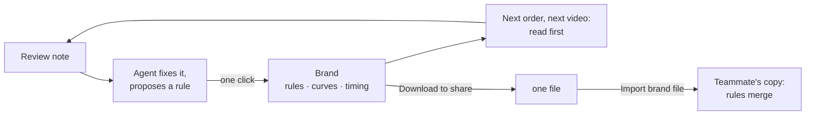
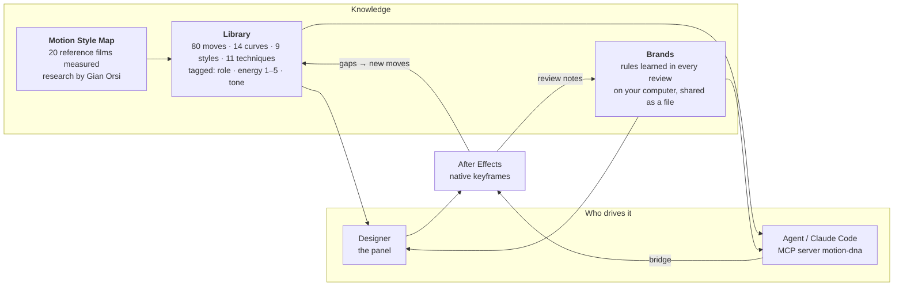
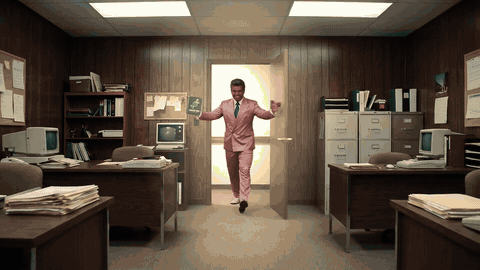

# Motion DNA

Motion made with AI all looks the same: same curves, same moves, same templates. **Motion DNA** gives it an identity.
It is a motion library for After Effects (80 moves, 14 curves, 9 styles, 11 techniques, built on measured references)
with a panel for designers and an AI agent that works inside After Effects. You direct; it accelerates. Every brand you
animate keeps a profile that **learns from each review**, and everything it makes is native keyframes.

**What you get**
- **Your motion, not the default.** Pick moves and curves by feel (energy 1 calm → 5 explosive, tone), hover to see
  them move, apply them to the selected layers. Already animated? Keep your keyframes and change only their timing and
  curve.
- **Brands that learn.** Each review note becomes a rule of that brand; the next order, the next video and the next
  person start from everything it learned. Share a brand with one file.
- **An agent that knows the library.** Ask in plain words ("animate these Figma frames in the Editorial style"); it uses
  the library, the brand and your selection, and shows what each order cost.
- **Claude where you prefer.** The same conversation continues in the panel, the Claude app or a terminal: one per brand
  and one per video.
- **Connect in one click.** Claude and Figma each have one button that turns green by itself.

 

## Get started

1. **Install** (Windows or macOS): double-click `INSTALL-Windows.cmd` / `INSTALL-macOS.command`, or run
   `python tools/setup.py` (or ask Claude to install Motion DNA). The panel is signed on your machine: no Adobe
   developer mode, no admin rights.
2. **Open After Effects** › **Window › Extensions › Motion DNA** (also *File › Scripts › Motion DNA*) and dock it once:
   it comes back every time. The link with Claude starts with After Effects by itself.
3. **Agent › Connect:** *Connect Claude* (sign in once) and, if you use Figma, *Connect Figma* (press Allow).
4. Once, in After Effects: *Preferences › Scripting & Expressions › Allow Scripts to Write Files and Access Network*.

Update with `python tools/setup.py --update` (never over your local changes) · remove with `--uninstall`.

Install details: signing, developer mode, the classic panel, where things live

- `setup.py` signs the panel (`panel/`, a CEP extension) on your machine with a self-signed certificate made with
  Adobe's ZXPSignCmd (downloaded once into `tools/.cache/`) and installs the signed copy, so After Effects loads it with
  no developer mode; `--update` signs it again.
- It also installs *File › Scripts › Motion DNA* (opens the panel) and a silent Startup script (starts the Claude bridge
  when After Effects opens), and removes entries older versions left. Fonts (Inter Tight, Instrument Serif, OFL) and the
  local asset-pack previews come with it.
- Developers: `python tools/setup.py --dev` runs the panel straight from the clone (edits show with **F5**); that needs
  Adobe's developer mode, and setup asks before turning it on (only you can say yes).
- The previous ScriptUI panel (`tools/ss_panel.jsx`) opens instead when the HTML panel is missing.
- Brands: templates in `library/brands/` (Motion DNA, the 22 rules learned making our promo); yours in
  `library/brands.local/` or a folder you choose. Terminal: `python tools/brand.py new | note | show | export | import`.
  Schema: [`library/brands/_schema.md`](library/brands/_schema.md).

## Use it

### Connect Claude and Figma

*Agent › Connect* has one button each. **Connect Claude** opens the sign-in (your Claude account) and turns green by
itself. **Connect Figma** opens Figma's own permission page: press Allow. The header shows **MCP · Claude · Figma**:
green is ready, a click opens Connect. When Figma asks for permission again, the same button reconnects it.

 

### Animate the selected layers: create, or modify what is there

**Behaviors**: choose a type (Moves, Classics, Text, Loops, Transitions, Recipes, Favorites), hover a preset to see it
move, tune *Duration · Intensity · Direction · Easing* and press the button, which says what it will do:
- **Create** when the layers have no keyframes;
- **Modify** when they already move: your keyframes and values stay, they get the preset's timing and curve;
- **Replace** to delete them and create the preset instead.

**Remove** cleans off what Motion DNA added. With *Marker timing*, drag the `SS in` / `SS out` markers to retime.

 

### Shape the curve

**Curves**: drag the handles or type `x1, y1, x2, y2`, or pick one of the library's curves (and the active brand's own
curves, first). **Apply to keyframes** eases the selected keyframes; with none selected, every keyframe of the selected
layers, keeping their values. **Read keys** loads a curve from your animation, **Save curve** adds yours to the library
or to the brand.

 

### A brand learns from every review

Tell the agent what to fix ("the car bounces, make it glide"): it fixes it and proposes the note as a **rule**. One
click keeps it in the **brand**, the **project** (only this video) or the **general** rules. *Brands › Rules* lists them:
add, edit or remove any. From then on, every order for that brand follows them, and so does Claude Code (`get_brand`).

 

### Share a brand, and know where it lives

*Brands › brand › Overview* says **where it lives** (its folder, with *Open folder*) and what each file is. **Download
to share** writes one file (`<brand>.motiondna-brand.json`); the other person presses **Import brand file**. If they
already have the brand, new, edited and removed rules merge into theirs and show as *new*: nothing is overwritten
blindly. Client brands never go in this repo (only templates do); conversations stay on each computer.

 

### Styles and techniques, ready to ask for

*Agent › Library* shows the **Styles** (a whole comp, role by role) and the **Techniques** (tracked labels, text behind
people, roto, speed ramps, HUD…) with a preview, what each one does and a ready order: **Use in chat** sends it to the
agent, **Copy order** takes it to Claude Code. Layers that already move keep their animation.

 

### One conversation per brand and per video

A brand has its own folder and its own Claude conversation for everything about it (*Brands › Claude › Start in Claude
app* puts it in the Claude app's sidebar). Each video is a **project** inside the brand folder (*Agent › Project*:
brief, references, footage, audio, AE, renders, exports), with its own conversation and rules. Continue any of them
from the panel, the Claude app or a terminal (*Copy terminal command*); the panel warns if it is open somewhere else.

 

### Claude Code and other agents
Open the repo (or a brand or project folder) in Claude Code and approve the `motion-dna` server. Claude can browse the
library (`list_presets`, `list_packs`, `list_tags`, `suggest_mix`, `match_reference`, `list_brands`, `get_brand`), act in
After Effects (`apply_preset`, `apply_pack`, `apply_brand` with `existing` = modify | replace, `add_asset`,
`remove_animation`), learn (`add_brand_note`) and check its work (`ae_status`, `list_layers`, `render_frame`). Without
MCP, any LLM reads `library/INDEX.txt` and runs `.jsx` jobs with `bash tools/bridge.sh`. Contributors: read
[`CLAUDE.md`](CLAUDE.md) and [`CONTRIBUTING.md`](CONTRIBUTING.md).

## How it works

The **library** is the vocabulary: moves, token curves (`tokens/`), styles and techniques, all tagged so they can be
recombined by feel. **Research feeds it**: reference films and brand analyses are measured and matched; whatever is
missing is created and tagged (CONTRIBUTING §8). **Brands remember**, and **every piece is checked**: the layout QA and
the tests catch problems, review notes become rules, new needs become new moves.

## What's inside

| Moves | Classics | Text | Loops | Recipes | Styles | Techniques | Curves |
|---|---|---|---|---|---|---|---|
| 32 | 17 | 11 | 11 | 9 | 9 | 11 | 14 + 6 durations |

Full catalog with live thumbnails: **[docs/CATALOG.md](docs/CATALOG.md)** · filterable: `library/index.html` · for LLMs:
`library/INDEX.txt` · tags: `library/tags.json`. All timing comes from the motion tokens: presets ask for `Arrive` +
`Land`, never a raw speed, so the whole library retunes in one place.

## Motion Style Map · research by Gian Orsi

Gian measured **20 reference films** (brand films, launches, explainers, reels) frame by frame and by ear: cuts, share of
time in motion, speed, colour, fitted Bézier curves for every move, and the music (BPM, pulse clarity, cuts on the beat
vs chance, shot length in beats). Each film sits on a map of **measured energy × scored tone**, and every film is broken
into **209 behaviors** named in Motion DNA's own terms (146 map to a preset, 47 are camera, edit or acting craft, 16 were
open gaps). What the library was missing became new pieces:

- **Curves:** `Coast`, `Nudge`, `Wind-up`, `Snap`.
- **Presets measured on real work:** Coast Rise, Wind-up Slide, Nudge Grow, Snap Scale, Iris Reveal, Wordmark Reveal,
  Push Through, Color Wipe, Chars Blur, Boil, On Twos.
- **Styles:** *Editorial*, *Storybook*, *Collage*.
- **How music shapes the edit:** shot length in beats separates styles better than BPM; key moments (logo, reveal) land on
  musical events; the logo pattern "mark first, wordmark slides out from behind it". The Motion DNA promo uses all three.

Explore it: [the map](research/style_map/style_map.html) · [taxonomy](research/style_map/taxonomy.md) ·
[behaviors and mapping](research/ontology/) · [family syntheses, music & edit, cross-family patterns](research/styles/) ·
pipeline in `tools/style_research/`.

## Rules that keep the work clean

Lessons from real reviews, checked automatically on the built comps by `tools/check_layout.jsx`: no text on text or cards
touching, nothing outside the safe area (labels stack into up to 3 lines instead), at least 32 px, contrast or a card,
nothing on a face, no substituted fonts. Edit rules: never cut a phrase, trim AI shots to their action, music leads the
key moments. All of them: [CONTRIBUTING §9](CONTRIBUTING.md#9-layout-and-edit-rules-every-video-every-comp).

## Showcases

### *Motion DNA · promo* (45 s, 1985 infomercial parody)

Two bored designers in 1985 complain that Claude makes the same animation every time; a salesman bursts in with Motion
DNA. Characters, location and props were designed as sheets first and every shot was generated with them as references
(Nano Banana 2.1 + Seedance 2.5, USD 15.50). The edit was built entirely by Claude with the library: 2D tracked callouts,
a planar-tracked "1985" on the wall, roto (local InSPyReNet mattes), a backlight glow, action lines, a freeze with the
person in colour, a retro app inside a curved CRT, words landing on the voice, music-led timing from the Style Map, and
the layout QA at 0 warnings. Video: [`media/motion_dna_promo/motion_dna_promo.mp4`](media/motion_dna_promo/motion_dna_promo.mp4) ·
story, shot list and costs: [`media/motion_dna_promo/story.md`](media/motion_dna_promo/story.md) · storyboard:
[Figma Slides](https://www.figma.com/slides/z2BSXVNVFhjYOlbBI1ZUy6).

| Tested: styles on one layout | Mix by tags | One move, the panel's controls |
|---|---|---|
|  |  |  |

Earlier showcases: the explainer, The 1974 Cypher, The 1974 Boardroom and the first tests

**Motion DNA · internal explainer** (68 s): how the library was built and how to use it, animated with the library
itself. [`docs/examples/ss_motion_explainer.mp4`](docs/examples/ss_motion_explainer.mp4) ·
[step by step](docs/case-studies/ss-motion-explainer.md). The promotional cut (67 s):
[`docs/examples/ss_motion_promo.mp4`](docs/examples/ss_motion_promo.mp4) · [step by step](docs/case-studies/ss-motion-promo.md).

| Our own curves | The plugin | Claude drives it |
|---|---|---|
|  |  |  |

**The 1974 Cypher** (32 s, speed-ramp test): orbital moves speed-ramped on the beat with the `Ramp` curve, tracked labels
on every detail, and a likeness QA. [`docs/examples/cypher_1974.mp4`](docs/examples/cypher_1974.mp4) ·
[step by step](docs/case-studies/the-1974-cypher.md).

| Ramp on the sneakers | Wide orbit + title | Tracked details |
|---|---|---|
|  |  |  |

**The 1974 Boardroom** (45 s): consistent AI shots, OpenCV tracking, AI roto, organic contours, face scans, titles behind
the people, a holographic HUD, freeze frames with kinetic type, a 70s announcer VO and a roto breakdown.
[`docs/examples/whisky_1974_boardroom.mp4`](docs/examples/whisky_1974_boardroom.mp4) ·
[step by step](docs/case-studies/the-1974-boardroom.md).

| "Zero keyframes." | "Tracked." | "Rotoscoped." |
|---|---|---|
|  |  |  |

| A Figma slide, animated | A draw-on intro | Text tracking on video | HUD on tracked points |
|---|---|---|---|
|  |  |  |  |

People in these earlier showcases are the project collaborators (Aaron Amortegui and Gian Orsi), who agreed to be test
subjects; every clip went through the face refinement pass. Prices, bottlings and roles are fictional.

## Documentation

- [`docs/CATALOG.md`](docs/CATALOG.md): every preset and style with its thumbnail.
- [`docs/TOOLS.md`](docs/TOOLS.md): every script, what it does and how to run it.
- [`CONTRIBUTING.md`](CONTRIBUTING.md): adding presets, open-source effects, styles, references, case studies; the layout and edit rules (§9).
- [`docs/LEARNINGS.md`](docs/LEARNINGS.md): every pitfall already solved (driving AE from an LLM, ExtendScript, rendering, AI footage, tracking and roto, typography, audio, costs).
- [`CLAUDE.md`](CLAUDE.md): the rules every Claude follows in this repo.

## Credits and requirements

Built by **Aaron Amortegui** and **Gian Orsi** (Motion Style Map research), with Claude. Classics adapt
[animate.css](https://animate.style) **4.1.1** (MIT, © 2020 Daniel Eden) into native keyframes; later releases changed
license and are not used. Fonts: Inter Tight and Instrument Serif (SIL OFL). Animation Composer is used only as a
behavioral reference: its presets are never decrypted, modified or redistributed, and its asset packs are indexed
locally, never committed.

**Requirements:** Windows or macOS · After Effects 2025/2026 · Python 3 (`numpy`, `opencv-python`, `scipy`, `Pillow`) ·
`ffmpeg` · Git LFS · a bash shell (Git Bash on Windows). Clone anywhere: scripts find the repo root on their own.
Platform details and overrides (`SS_AFTERFX`, `SS_AE_APP`, `SS_AERENDER`, `SS_ASSET_PACKS`): [docs/TOOLS.md](docs/TOOLS.md)
and [docs/LEARNINGS.md](docs/LEARNINGS.md).
