# Motion DNA · catalog

Every preset with its live thumbnail, energy and use, generated from `library/library.json`, `library/recipes.json` and
`library/packs.json` by `python tools/readme_catalog.py`. Filterable version: open `library/index.html`; for LLMs:
`library/INDEX.txt`. Tags (roles, targets, energy 1–5, tones) for every entry: `library/tags.json`.

<!-- catalog:start -->
**80 presets** in 5 categories, plus style packs. Every one is also listed in `library/INDEX.txt` (for LLMs) and `library/index.html` (for people).

### Motion (32)

Entrances and exits for any layer. `SSP.apply(layer, name, "in" | "out" | "both")`

|   |   |   |   |
|---|---|---|---|
|  **Fade** · `soft` Corporate, UI, supporting text |  **Fade Up** · `soft` Headlines, paragraphs, lists |  **Scale Pop** · `dynamic` Icons, chips, stickers, social |  **Blur In** · `soft` Photos, backgrounds, premium moments |
|  **Slide Land** · `medium` Images and cards entering from off-screen |  **Rotate Settle** · `medium` Logos, badges, pieces with personality |  **Squash Warp** · `dynamic` Social, hype, rhythmic transitions |  **Wipe Reveal** · `medium` Bars, lower thirds, underlines |
|  **Organic Draw** · `medium` Hand-drawn feel: contours, underlines, sketch lines (shape layers only) |  **Organic Stroke** · `dynamic` Traveling brush stroke: the start chases the end (accent lines, HUD links) |  **Line Draw** · `medium` Lines, stroke icons, tracking HUD (shape layers only) |  **Slam In** · `dynamic` Hero words, titles over footage, kinetic type |
|  **Flip In** · `medium` Cards, tiles, reveals, before/after |  **Spin Pop** · `dynamic` Badges, stickers, stamps, icons |  **Drop Bounce** · `dynamic` Icons, products, emoji, playful drops |  **Stretch Slide** · `dynamic` Cards, chips, pills, fast UI moves |
|  **Ramp Slide** · `dynamic` Transitions, product slides, bold entrances |  **Ramp Zoom** · `dynamic` Logo reveals, hero products, end cards |  **Ramp Spin** · `dynamic` Icons, badges, logo spins |  **Whip Pan** · `dynamic` Swipe transitions, camera-style moves, carousels |
|  **Surge Rise** · `medium` Headlines, cards, elegant entrances |  **Speed Ramp** · `dynamic` Footage, product shots, action beats, transitions |  **Punch Zoom** · `medium` Footage, precomps, freeze frames, cut emphasis |  **Coast Rise** · `soft` Product UI, editorial headlines, icons: fast start, clean stop |
|  **Glide In** · `soft` Products, cars, premium heroes: a long glide in that settles, no bounce |  **Wind-up Slide** · `soft` Logo slides, premium reveals: a small pull-back, then a long glide |  **Nudge Grow** · `soft` Bars, charts, columns, panels growing from their anchor (put the anchor at the base) |  **Snap Scale** · `medium` Editorial cuts on the action: shapes and type that jump in size and settle |
|  **Iris Reveal** · `medium` Scene changes, photo reveals, opening a new section from a point |  **Wordmark Reveal** · `medium` Wordmarks sliding out from behind their logo mark, names after an icon |  **Push Through** · `medium` Fly-through transitions: the camera pushes into a word, a logo or a planet and through it |  **Color Wipe** · `medium` Section changes: a full-frame color solid sweeps in diagonally (put it on a solid) |

### Classics (17)

Effects adapted from animate.css 4.1.1 (MIT) into native keyframes: entrances, exits and attention moves. Same call as Motion.

|   |   |   |   |
|---|---|---|---|
|  **Back In Down** · `dynamic` Cards, product shots, bold drops (enter) |  **Back In Left** · `dynamic` Slides, lower thirds, carousels (enter) |  **Bounce In** · `dynamic` Icons, badges, buttons, emoji (enter) |  **Bounce In Up** · `dynamic` Notifications, stickers, playful entrances (enter) |
|  **Rubber Band** · `dynamic` CTAs, logos, a beat accent (attention) |  **Jello** · `dynamic` Playful accents, stickers (attention) |  **Heart Beat** · `medium` Likes, prices, a pulse on the beat (attention) |  **Tada** · `dynamic` Reveals, wins, offers (attention) |
|  **Wobble** · `dynamic` Errors, jokes, quirky accents (attention) |  **Swing Hinge** · `medium` Signs, tags, hanging elements (attention) |  **Flip In X** · `medium` Cards, tiles, scoreboard flips (enter) |  **Light Speed In** · `dynamic` Speed, sport, fast lower thirds (enter) |
|  **Roll In** · `dynamic` Wheels, coins, round icons (enter) |  **Zoom In Down** · `medium` Titles that drop in from above (enter) |  **Jack In The Box** · `dynamic` Surprises, reveals, kids and playful brands (enter) |  **Back Out Up** · `dynamic` Exits upward, cards leaving (exit) |
|  **Zoom Out** · `soft` Quiet exits, scene changes (exit) |   |   |   |

### Text (11)

Per character or per word, on text layers. `SSP.applyText(layer, name, "in" | "out" | "both")`

|   |   |   |   |
|---|---|---|---|
|  **Chars Rise** · `medium` Short headlines, names, kickers |  **Words Fade Up** · `soft` Phrases, captions, quotes |  **Blur Words** · `soft` Premium moments, calm intros |  **Tracking Settle** · `medium` All-caps titles, typographic logos |
|  **Chars Pop** · `dynamic` Social, hype, big numbers |  **Typewriter** · `medium` Captions, terminals, UI, quotes |  **Scramble** · `dynamic` Tech, data, HUD labels, reveals |  **Count Up** · `medium` Stats, KPIs, prices, counters |
|  **Chars Ramp** · `medium` Titles that build tension, trailers, reveals |  **Words Slam** · `dynamic` Punchy statements, social hooks, VO beats |  **Chars Blur** · `soft` Opening titles, premium intros: characters resolve from blur one after another |   |

### Effects (11)

Continuous loops driven by expressions. `SSP.applyFx(layer, name)`

|   |   |   |   |
|---|---|---|---|
|  **Float** · `soft` Idle icons and cards, living backgrounds |  **Wiggle Rotate** · `medium` Stickers, illustrations with personality |  **Pulse** · `medium` CTAs, buttons, attention grabbers |  **Jitter** · `dynamic` Social, glitch, high-energy pieces |
|  **Breathe** · `soft` Ambient glows, background shapes, calm idle states |  **Swing** · `soft` Hanging tags, badges, signs, pendulums |  **Orbit** · `soft` Dots and satellites around a logo, decorative loops |  **Shake** · `dynamic` Impacts, bass hits, alarms, energetic footage |
| 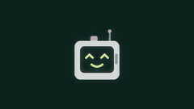 **Holo Flicker** · `medium` HUD labels, tech overlays, holographic UI |  **Boil** · `medium` Collage, cut-outs, paper and texture layers: a subtle hand-made boil |  **On Twos** · `medium` Stop-motion feel: plays the layer's existing animation on 2s or 3s (apply after a motion preset) |   |

### Recipes (9)

Behavior measured from reference animations and rebuilt with our own keyframes. `SSP.applyRecipe(layer, id, "both")`

|   |   |   |   |
|---|---|---|---|
|  **W3L** · `dynamic` position & rotation & scale · loop |  **4LC** · `dynamic` position & rotation · transition | 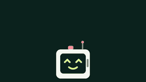 **D2T** · `dynamic` position · loop |  **2JK** · `medium` rotation · loop |
|  **1DF+UNU** · `dynamic` scale · loop |  **X9R** · `medium` opacity & scale · transition |  **PE6** · `medium` position · transition | 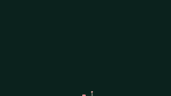 **4VW** · `dynamic` position & scale · transition |
|  **2JV** · `dynamic` scale · transition |   |   |   |

### Packs (9)

One click gives a whole comp an identity: each layer gets the preset of its role (title, subtitle, body, shape, media, logo), staggered. `SSP.applyPack(comp, name)`

|   |   |   |   |
|---|---|---|---|
| 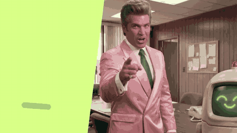 **Dynamic** · `dynamic` Social, launches, hype: fast slams, whips and speed ramps. | 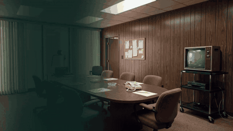 **Elegant** · `soft` Premium, fashion, hospitality: slow blurs, soft rises, generous timing. | 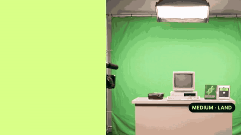 **Modern** · `medium` Corporate, SaaS, product: clean rises and slides on the brand curves. | 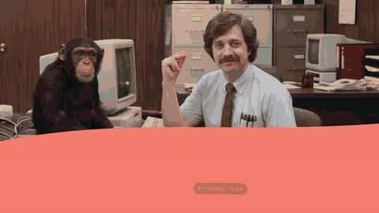 **Playful** · `dynamic` Kids, food, consumer apps: bounces, wobbles and jack-in-the-box reveals. |
| 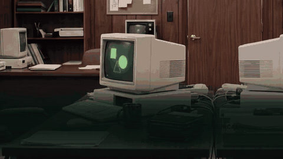 **Tech** · `medium` Data, AI, fintech, HUDs: decoding text, line draws and holographic flicker. |  **Calm Modern** · `soft` Product and brand pieces: small travel, word-by-word text, quiet exits, no bounce. | 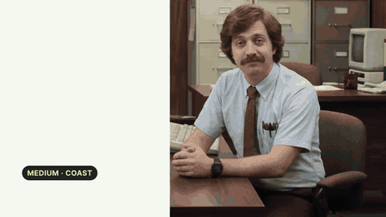 **Editorial** · `medium` Brand systems, tech launches, type-led films: typing, snaps on the action, construction lines, clean ease-outs (Motion Style Map: Editorial). | 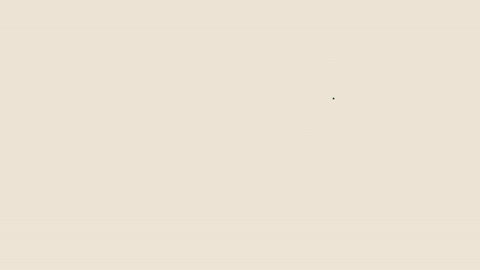 **Storybook** · `soft` Warm product launches and character explainers: line-by-line rises, soft 3% overshoots, circular reveals (Motion Style Map: Warm editorial, Character). |
| 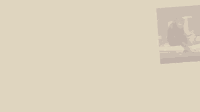 **Collage** · `dynamic` Mixed media, cut-outs, archive and texture: whips through layers, hand-made boil on 3s, decoding type (Motion Style Map: Mixed media). |   |   |   |

## The kit (159 pieces)

Built by Claude on the open comp through the MCP server, on the same token curves. Ask for them by name in the chat; `list_kit` shows energy and tones. Techniques (like the stroke build of our logo) are in the panel's Library and `library/techniques.json`.

### Solid transitions (34)

Colour layers and masks over a cut, one controller (Progress, Direction, Stagger, Ease In/Out, Color 1-3). `solid_transition(look=…)`

|   |   |   |   |
|---|---|---|---|
| 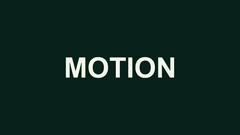 **Clean Wipe** · `energy 2-3` One colour panel crosses the frame: the neutral default between scenes. `solid_transition(look="Clean Wipe")` | 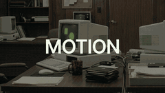 **Diagonal Wipe** · `energy 3-4` A wipe with more drive; pairs with diagonal layouts. `solid_transition(look="Diagonal Wipe")` | 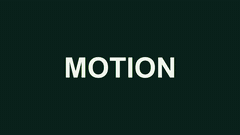 **Vertical Drop** · `energy 3-4` Panel falls from the top: social and list beats. `solid_transition(look="Vertical Drop")` |  **Color Stack** · `energy 3-4` Brand colours slide in one over the other and back off in reverse: the signature AC look. `solid_transition(look="Color Stack")` |
| 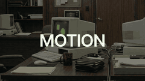 **Stack Rise** · `energy 3-4` Colour stack rising from the bottom. `solid_transition(look="Stack Rise")` | 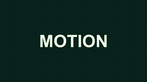 **Slanted Bars** · `energy 3-4` Diagonal bars from the middle outward. `solid_transition(look="Slanted Bars")` |  **Bar Cascade** · `energy 3-3` Horizontal bars arrive top to bottom like a list. `solid_transition(look="Bar Cascade")` | 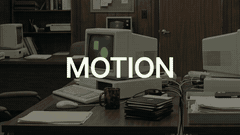 **Venetian Blinds** · `energy 2-3` Slats grow across, then shrink away: a classic, tidy reveal. `solid_transition(look="Venetian Blinds")` |
|  **Shutter** · `energy 3-4` Many thin slats, fast: tech and data pieces. `solid_transition(look="Shutter")` |  **Center Split** · `energy 3-4` Two halves close from the sides and open again: doors. `solid_transition(look="Center Split")` | 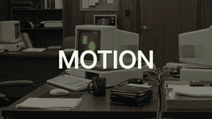 **Horizon Split** · `energy 3-4` Halves close from top and bottom. `solid_transition(look="Horizon Split")` | 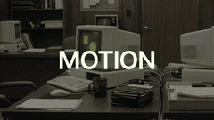 **Zipper** · `energy 4-5` Alternating bars from both sides, tilted: high-energy social. `solid_transition(look="Zipper")` |
| 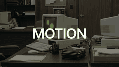 **Comb** · `energy 4-5` Thin interleaved strips, very fast. `solid_transition(look="Comb")` |  **Iris Pop** · `energy 3-4` A circle grows over the frame and opens a hole to the next shot. `solid_transition(look="Iris Pop")` |  **Ring Burst** · `energy 4-5` Concentric colour rings burst out and open back in reverse. `solid_transition(look="Ring Burst")` |  **Diamond Reveal** · `energy 3-4` Rotated-square panels from the centre. `solid_transition(look="Diamond Reveal")` |
|  **Pixel Grid** · `energy 3-4` Checker cells fill diagonally then empty. `solid_transition(look="Pixel Grid")` | 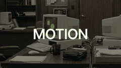 **Grid Scatter** · `energy 4-5` Random cells flicker in and out: glitchy, digital. `solid_transition(look="Grid Scatter")` | 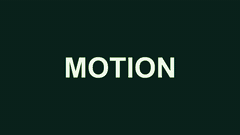 **Grid Bloom** · `energy 3-4` Cells bloom from the centre. `solid_transition(look="Grid Bloom")` | 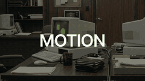 **Soft Wipe** · `energy 1-2` Slow, soft single panel for calm pieces. `solid_transition(look="Soft Wipe")` |
|  **Corner Burst** · `energy 4-5` Colour rings burst from a corner and pull back into it. `solid_transition(look="Corner Burst")` | 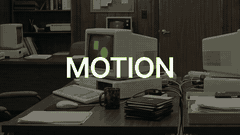 **Rainbow Rise** · `energy 3-4` Concentric arcs rise from the bottom edge (use 3+ colours). `solid_transition(look="Rainbow Rise")` | 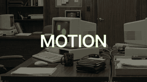 **Dot Matrix** · `energy 3-4` Round cells swell into a dot matrix and shrink away. `solid_transition(look="Dot Matrix")` | 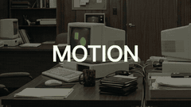 **Fan Sweep** · `energy 3-4` Pie slices sweep round the centre like a fan. `solid_transition(look="Fan Sweep")` |
| 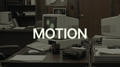 **Corner Fan** · `energy 4-5` Slices fan out from a corner. `solid_transition(look="Corner Fan")` | 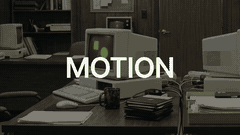 **Gradient Wipe** · `energy 2-3` One panel with a gradient between two brand colours. `solid_transition(look="Gradient Wipe")` |  **Liquid Wipe** · `energy 2-3` Colour layers with a living wavy edge flow over the cut and away (one colour = tonal shades). `solid_transition(look="Liquid Wipe")` | 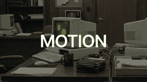 **Liquid Rise** · `energy 2-3` The liquid wipe rising from the bottom. `solid_transition(look="Liquid Rise")` |
| 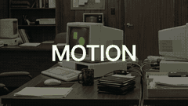 **Ink Drop** · `energy 2-3` Ink blooms with wobbly edges and opens a wobbly hole to the next shot. `solid_transition(look="Ink Drop")` | 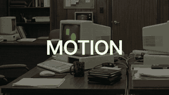 **Ink Corner** · `energy 2-3` Ink spreading from a corner. `solid_transition(look="Ink Corner")` |  **Bubble Wipe** · `energy 2-4` Liquid bubbles bloom from the centre and merge over the frame in two colours, then bubbles of the next shot eat through them. `solid_transition(look="Bubble Wipe")` | 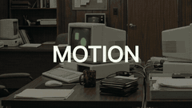 **Bubble Rise** · `energy 3-4` The bubble wipe boiling up from the bottom. `solid_transition(look="Bubble Rise")` |
| 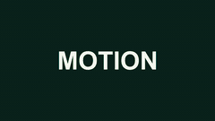 **Shatter** · `energy 3-4` Voronoi shards pop in from the centre in three colours, then shrink away to the next shot. `solid_transition(look="Shatter")` | 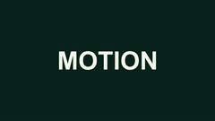 **Shard Sweep** · `energy 3-5` Voronoi shards sweep across from the left and fall away. `solid_transition(look="Shard Sweep")` |   |   |

### Clip transitions (12)

Shot to shot (outgoing / incoming layers). `solid_transition(look=…, outgoing=…, incoming=…)`

|   |   |   |   |
|---|---|---|---|
| 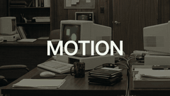 **Zoom Through** · `energy 3-4` Clip to clip: the shot pushes in with blur and the next lands from a push, with a small overshoot. `solid_transition(look="Zoom Through")` |  **Spin Through** · `energy 4-5` Clip to clip: rotate through the cut with blur; scaled so the frame never shows an edge. `solid_transition(look="Spin Through")` | 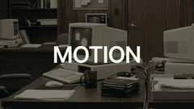 **Stretch Slide** · `energy 4-5` Clip to clip: the shot slides out stretching and the next squashes in, with motion blur. `solid_transition(look="Stretch Slide")` | 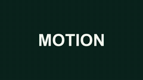 **Whip Slide** · `energy 3-4` Clip to clip: a whip pan between shots, with motion blur. `solid_transition(look="Whip Slide")` |
| 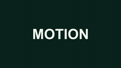 **Vertical Whip** · `energy 3-4` Clip to clip: whip upward (social feeds, lists). `solid_transition(look="Vertical Whip")` | 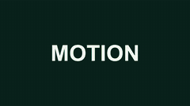 **Flash Cut** · `energy 4-5` Clip to clip: a white flash peaks on the cut. `solid_transition(look="Flash Cut")` | 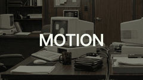 **Dip to Black** · `energy 1-2` Clip to clip: blur and dip through black. `solid_transition(look="Dip to Black")` |  **Camera Shake** · `energy 4-5` Clip to clip: a hard cut inside a decaying camera shake (impacts, beats). `solid_transition(look="Camera Shake")` |
|  **Twirl Zoom** · `energy 4-5` Clip to clip: twirl and push through the cut. `solid_transition(look="Twirl Zoom")` |  **Slice Cut** · `energy 4-5` Clip to clip: the shot breaks into slices that slide off over the next. `solid_transition(look="Slice Cut")` | 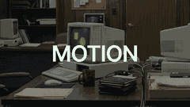 **Glitch Cut** · `energy 4-5` Clip to clip: RGB split and jumps across the cut. `solid_transition(look="Glitch Cut")` | 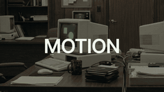 **Camera Roll** · `energy 4-5` Clip to clip: a half roll through the cut, frame always covered. `solid_transition(look="Camera Roll")` |

### Elements (27)

Self-sizing graphics with one controller (Reveal, Padding, Radius, Gap, Box/Accent/Text). `add_element(kind=…)`

|   |   |   |   |
|---|---|---|---|
|  **label** · `energy 2-3` Chip that hugs its text, grows from the left. `add_element(kind="label", …)` | 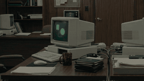 **lower_third** · `energy 2-3` Name and role on a box with an accent bar. `add_element(kind="lower_third", …)` |  **title** · `energy 2-3` Display title with an accent rule and subtitle. `add_element(kind="title", …)` |  **underline** · `energy 2-3` Accent line under an existing text layer. `add_element(kind="underline", …)` |
|  **highlight** · `energy 2-3` Marker highlight behind an existing text layer. `add_element(kind="highlight", …)` | 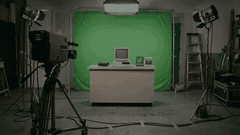 **callout** · `energy 2-3` Dot and leader line to a label (product features). `add_element(kind="callout", …)` | 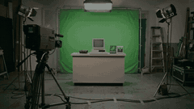 **counter** · `energy 2-3` Number counting to a value with prefix/suffix (KPIs, prices). `add_element(kind="counter", …)` |  **timer** · `energy 2-4` mm:ss.cc running or counting down. `add_element(kind="timer", …)` |
|  **price_tag** · `energy 2-3` Big price over a small label. `add_element(kind="price_tag", …)` |  **handle** · `energy 2-3` @handle pill (generic, no network logos). `add_element(kind="handle", …)` |  **bubble** · `energy 2-3` Speech bubble with a tail. `add_element(kind="bubble", …)` |  **sticker** · `energy 4-5` Outlined word that pops in tilted (reactions). `add_element(kind="sticker", …)` |
|  **quote** · `energy 1-2` Quote card: big quote mark, paragraph, author. `add_element(kind="quote", …)` | 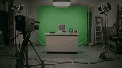 **list** · `energy 2-3` Bullet list, lines staggered. `add_element(kind="list", …)` |  **progress** · `energy 2-3` Bar filling to a value with a counting %. `add_element(kind="progress", …)` | 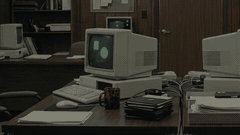 **button** · `energy 3-4` Button that a cursor clicks; swaps label and colours. `add_element(kind="button", …)` |
|  **kinetic** · `energy 4-5` Lines fitted to one width sliding in from alternate sides. `add_element(kind="kinetic", …)` |  **tiles** · `energy 3-4` Each letter on a tile flipping in (3D). `add_element(kind="tiles", …)` |  **text_box** · `energy 1-2` Title over a paragraph on a box. `add_element(kind="text_box", …)` |  **media** · `energy 2-3` Framed image slot with a title; fits a layer into it. `add_element(kind="media", …)` |
|  **scale_title** · `energy 3-4` Title pushes in (mode push) or drops in (mode drop). `add_element(kind="scale_title", …)` |  **cinematic** · `energy 1-3` Title styles: neon, blur, kerning. `add_element(kind="cinematic", …)` |  **chat** · `energy 2-3` Chat bubble: typing dots, then the message. `add_element(kind="chat", …)` | 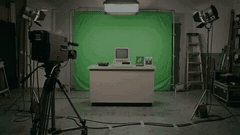 **rating** · `energy 2-3` Five stars, the value ones fill and pop. `add_element(kind="rating", …)` |
| 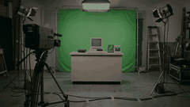 **ring** · `energy 2-3` Progress ring drawing to a value with a counting %. `add_element(kind="ring", …)` |  **glass_card** · `energy 1-2` Smoky frosted card that blurs what is behind it, title and line. `add_element(kind="glass_card", text=…, sub=…)` |  **end_card** · `energy 2-3` Logo close: the mark builds piece by piece (stroke build with grain), then the wordmark rises behind line masks. Stacked (as on the box) or horizontal. Closes every Motion DNA demo. `add_element(kind="end_card", text="Motion DNA", sub=tagline, style="horizontal"?)` |   |

### Shapes (39)

Animated shape families that draw on, hold and leave. `add_shape(kind=…)`

|   |   |   |   |
|---|---|---|---|
|  **circle** · `energy 2-4` Filled circle (pop). `add_shape(kind="circle", …)` |  **ring** · `energy 2-3` Ring drawing on. `add_shape(kind="ring", …)` |  **square** · `energy 2-3` Square (pop). `add_shape(kind="square", …)` |  **frame** · `energy 2-3` Rectangle outline drawing on. `add_shape(kind="frame", …)` |
|  **triangle** · `energy 3-4` Triangle (pop). `add_shape(kind="triangle", …)` |  **diamond** · `energy 3-4` Diamond (pop). `add_shape(kind="diamond", …)` |  **pentagon** · `energy 2-3` Pentagon. `add_shape(kind="pentagon", …)` |  **hexagon** · `energy 2-3` Hexagon. `add_shape(kind="hexagon", …)` |
|  **star** · `energy 3-5` Star (pop). `add_shape(kind="star", …)` |  **sparkle** · `energy 3-4` Four-point sparkle. `add_shape(kind="sparkle", …)` |  **badge** · `energy 3-4` Scalloped seal badge. `add_shape(kind="badge", …)` |  **heart** · `energy 3-4` Heart. `add_shape(kind="heart", …)` |
|  **shield** · `energy 2-3` Shield / crest. `add_shape(kind="shield", …)` |  **cross** · `energy 3-4` X mark drawing on. `add_shape(kind="cross", …)` |  **plus** · `energy 2-3` Plus drawing on. `add_shape(kind="plus", …)` |  **check** · `energy 2-3` Check mark drawing on. `add_shape(kind="check", …)` |
|  **line** · `energy 1-3` Straight line drawing on. `add_shape(kind="line", …)` |  **wave** · `energy 2-3` Sine wave drawing on. `add_shape(kind="wave", …)` |  **zigzag** · `energy 3-4` Zigzag drawing on. `add_shape(kind="zigzag", …)` |  **arrow** · `energy 2-3` Arrow drawing on. `add_shape(kind="arrow", …)` |
|  **curved_arrow** · `energy 2-3` Curved arrow drawing on. `add_shape(kind="curved_arrow", …)` |  **chevrons** · `energy 3-4` Chevrons >>> drawing on. `add_shape(kind="chevrons", …)` |  **brackets** · `energy 2-3` Four corner brackets (focus frame). `add_shape(kind="brackets", …)` |  **spiral** · `energy 3-4` Spiral drawing on. `add_shape(kind="spiral", …)` |
|  **infinity** · `energy 2-3` Infinity loop drawing on. `add_shape(kind="infinity", …)` |  **brush** · `energy 3-4` Tapered brush stroke. `add_shape(kind="brush", …)` |  **speed_lines** · `energy 4-5` Horizontal speed lines. `add_shape(kind="speed_lines", …)` |  **burst** · `energy 4-5` Rays fly out and vanish. `add_shape(kind="burst", …)` |
|  **impact** · `energy 4-5` Impact rays over a spread (360/180/90/45°), mirror. `add_shape(kind="impact", …)` |  **rings** · `energy 3-4` Shockwave: rings expand, thin out and fade. `add_shape(kind="rings", …)` |  **loader** · `energy 2-3` Arc that keeps turning. `add_shape(kind="loader", …)` |  **dots** · `energy 2-3` Row of dots popping. `add_shape(kind="dots", …)` |
|  **pops** · `energy 4-5` Particles burst from the centre, spin and shrink away. `add_shape(kind="pops", …)` |  **shape_row** · `energy 3-4` Row of small shapes popping. `add_shape(kind="shape_row", …)` |  **fireworks** · `energy 4-5` Staggered bursts at a few spots. `add_shape(kind="fireworks", …)` |  **glitter** · `energy 3-4` Twinkling sparkles (loop). `add_shape(kind="glitter", …)` |
|  **swoosh** · `energy 4-5` Three curved strokes echoing along a curve. `add_shape(kind="swoosh", …)` |  **confetti** · `energy 4-5` Confetti burst with gravity. `add_shape(kind="confetti", …)` |  **blob** · `energy 1-3` Liquid blob that keeps breathing. `add_shape(kind="blob", …)` |   |

### Backgrounds (10)

Looping procedural backgrounds in brand colours. `add_look(kind=…)`

|   |   |   |   |
|---|---|---|---|
| 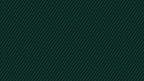 **stripes** · `energy 2-3` Diagonal stripes drifting (loop). `add_look(kind="stripes", …)` |  **dots** · `energy 1-2` Dot grid drifting. `add_look(kind="dots", …)` |  **grid** · `energy 1-2` Line grid drifting. `add_look(kind="grid", …)` |  **gradient** · `energy 1-2` Four-colour gradient drifting. `add_look(kind="gradient", …)` |
|  **liquid** · `energy 1-2` Liquid gradient flowing. `add_look(kind="liquid", …)` |  **topo** · `energy 1-2` Topographic contour lines. `add_look(kind="topo", …)` |  **network** · `energy 1-3` Plexus: drifting points joined by lines that fade with distance. `add_look(kind="network", …)` |  **blobs** · `energy 1-2` Liquid shapes in brand colours breathing and drifting. `add_look(kind="blobs", …)` |
|  **mesh** · `energy 1-2` Mesh gradient: big colour fields drifting under a heavy blur. `add_look(kind="mesh", …)` |  **glass** · `energy 1-2` Mesh gradient behind floating frosted-glass panes. `add_look(kind="glass", …)` |   |   |

### Looks (11)

Finishing layers over a comp. `add_look(kind=…)`

|   |   |   |   |
|---|---|---|---|
|  **tritone** · `energy 1-3` Three-colour tone over everything. `add_look(kind="tritone", …)` |  **duotone** · `energy 1-3` Two-colour tone. `add_look(kind="duotone", …)` |  **vignette** · `energy 1-2` Dark edges. `add_look(kind="vignette", …)` |  **grain** · `energy 1-3` Film grain. `add_look(kind="grain", …)` |
|  **scanlines** · `energy 2-3` Moving scanlines. `add_look(kind="scanlines", …)` |  **letterbox** · `energy 1-3` Cinema bars (animate in with t). `add_look(kind="letterbox", …)` |  **dust** · `energy 1-2` Floating dust. `add_look(kind="dust", …)` |  **embers** · `energy 2-3` Rising embers. `add_look(kind="embers", …)` |
|  **snow** · `energy 1-2` Falling snow. `add_look(kind="snow", …)` |  **long_shadow** · `energy 2-3` Flat long shadow on a layer. `add_look(kind="long_shadow", …)` |  **glitch** · `energy 4-5` RGB split + jumps burst on a layer. `add_look(kind="glitch", …)` |   |

### Text engine (10)

Per char, word or line on token curves; captions from word timings. `animate_text(…)`, `add_captions(…)`

|   |   |   |   |
|---|---|---|---|
|  **Chars Pop Rise** · `energy 3-4` Letters rise with overshoot. `animate_text(unit="chars", channels=["fade","rise"], ease="Pop")` |  **Words Decode** · `energy 3-4` Words scramble in, flickering. `animate_text(unit="words", channels=["decode","fade"], mode="flicker")` |  **Lines Mask Rise** · `energy 2-3` Lines slide up from behind a mask. `animate_text(unit="lines", channels=["rise"], mask=true)` |  **Chars 3D Flip** · `energy 3-4` Letters flip in on X from the centre. `animate_text(unit="chars", channels=["rotate3d","fade"], order="center", ease="Nudge")` |
|  **Chars Wiggly Scale** · `energy 4-5` Letters pop with a wobble, random order. `animate_text(unit="chars", channels=["scale"], mode="wiggly", order="random")` |  **Words Tracking Blur** · `energy 1-2` Words settle from wide spacing and blur. `animate_text(unit="words", channels=["tracking","blur","fade"])` |  **Chars Skew Slide** · `energy 3-4` Letters whip in skewed. `animate_text(unit="chars", channels=["skew","slide","fade"], ease="Whip")` |  **Words Colour Pop** · `energy 3-4` Words pop through the accent colour. `animate_text(unit="words", channels=["color","scale"], ease="Pop")` |
|  **Typewriter Cursor** · `energy 2-3` Types with a blinking cursor. `animate_text(typewriter=true, cps=18)` |  **Captions** · `energy 2-3` Word-timed captions (highlight, karaoke, build, pop, word). `add_captions(words_path=…, style="highlight")` |   |   |

### Moves (7)

2D/3D entrances and exits. `move(move=…)`

|   |   |   |   |
|---|---|---|---|
|  **flip** · `energy 3-4` Card turn on the anchor (3D). `move(move="flip", layers=[…])` |  **hinge** · `energy 3-4` Door swing on an edge (3D). `move(move="hinge", layers=[…])` |  **orbit** · `energy 3-4` Swings in round a distant pivot (carousel). `move(move="orbit", layers=[…])` |  **fly** · `energy 3-5` Z fly-in from far or near. `move(move="fly", layers=[…])` |
|  **tumble** · `energy 4-5` Fly-in while turning on two axes. `move(move="tumble", layers=[…])` |  **grow_edge** · `energy 2-3` Grows from an edge, one axis or uniform. `move(move="grow_edge", layers=[…])` |  **squash** · `energy 3-5` One-axis bounce (squash and stretch). `move(move="squash", layers=[…])` |   |

### Behaviours (9)

An algorithm drawn into a target (shape, background, mask, box, transition, layer). `add_behavior(behavior=…, target=…)`

|   |   |   |   |
|---|---|---|---|
|  **bubbles** · `energy 2-4` Liquid bubbles that bloom from the origin and melt into each other (metaballs: blur + alpha threshold); as a background they rise like a lava lamp. `add_behavior(behavior="bubbles", target="shape", …)` |  **blob** · `energy 2-3` One liquid blob growing from the origin with a breathing edge (shared by the ink transition, the blob shape and the blobs background). `add_behavior(behavior="blob", target="shape", …)` |  **voronoi** · `energy 3-4` Voronoi cells: the region shatters into drifting cells that pop in from the origin (shards, stained glass, cells). `add_behavior(behavior="voronoi", target="background", …)` |  **grow** · `energy 1-3` Organic growth: branches grow from the origin, wander and split like vines or roots, tapering each generation, buds at the tips. `add_behavior(behavior="grow", target="shape", …)` |
|  **flow** · `energy 1-2` Noise flow field: streamlines that follow a slowly turning noise field, like wind or water currents. `add_behavior(behavior="flow", target="background", …)` |  **flock** · `energy 2-3` A flock or school crossing a region: a leader wanders on noise, members trail with their own lag and orbit, turned to their heading. `add_behavior(behavior="flock", target="shape", …)` |  **spring** · `energy 3-4` Jelly box: a rounded rectangle on the token curve whose edges lag and wobble like damped springs driven by the curve's speed, then settle. `add_behavior(behavior="spring", target="box", …)` |  **rope** · `energy 2-3` Verlet rope: pinned at one end, the other carried into place on the token curve; it pays out, sags, swings and settles (an underline under a layer). `add_behavior(behavior="rope", target="shape", …)` |
|  **line_boil** · `energy 2-4` Hand-drawn line boil on any existing layer: outlines tremble as if redrawn on 3s (three drawings cycling). Shapes get Wiggle Paths, everything else a fine Turbulent Displace. The Collage style applies it. `add_behavior(behavior="line_boil", target="layer", …)` |   |   |   |
<!-- catalog:end -->
