# Motion DNA · catalog

Every preset with its live thumbnail, energy and use, generated from `library/library.json`, `library/recipes.json` and
`library/packs.json` by `python tools/readme_catalog.py`. Filterable version: open `library/index.html`; for LLMs:
`library/INDEX.txt`. Tags (roles, targets, energy 1–5, tones) for every entry: `library/tags.json`.

<!-- catalog:start -->
**80 presets** in 5 categories, plus style packs. Every one is also listed in `library/INDEX.txt` (for LLMs) and `library/index.html` (for people).

### Motion (32)

Entrances and exits for any layer. `SSP.apply(layer, name, "in" | "out" | "both")`

|   |   |   |   |
|---|---|---|---|
|  **Fade** · `soft` Corporate, UI, supporting text |  **Fade Up** · `soft` Headlines, paragraphs, lists |  **Scale Pop** · `dynamic` Icons, chips, stickers, social |  **Blur In** · `soft` Photos, backgrounds, premium moments |
|  **Slide Land** · `medium` Images and cards entering from off-screen |  **Rotate Settle** · `medium` Logos, badges, pieces with personality |  **Squash Warp** · `dynamic` Social, hype, rhythmic transitions |  **Wipe Reveal** · `medium` Bars, lower thirds, underlines |
|  **Organic Draw** · `medium` Hand-drawn feel: contours, underlines, sketch lines (shape layers only) |  **Organic Stroke** · `dynamic` Traveling brush stroke: the start chases the end (accent lines, HUD links) |  **Line Draw** · `medium` Lines, stroke icons, tracking HUD (shape layers only) |  **Slam In** · `dynamic` Hero words, titles over footage, kinetic type |
|  **Flip In** · `medium` Cards, tiles, reveals, before/after |  **Spin Pop** · `dynamic` Badges, stickers, stamps, icons |  **Drop Bounce** · `dynamic` Icons, products, emoji, playful drops |  **Stretch Slide** · `dynamic` Cards, chips, pills, fast UI moves |
|  **Ramp Slide** · `dynamic` Transitions, product slides, bold entrances |  **Ramp Zoom** · `dynamic` Logo reveals, hero products, end cards |  **Ramp Spin** · `dynamic` Icons, badges, logo spins |  **Whip Pan** · `dynamic` Swipe transitions, camera-style moves, carousels |
|  **Surge Rise** · `medium` Headlines, cards, elegant entrances |  **Speed Ramp** · `dynamic` Footage, product shots, action beats, transitions |  **Punch Zoom** · `medium` Footage, precomps, freeze frames, cut emphasis |  **Coast Rise** · `soft` Product UI, editorial headlines, icons: fast start, clean stop |
|  **Glide In** · `soft` Products, cars, premium heroes: a long glide in that settles, no bounce |  **Wind-up Slide** · `soft` Logo slides, premium reveals: a small pull-back, then a long glide |  **Nudge Grow** · `soft` Bars, charts, columns, panels growing from their anchor (put the anchor at the base) |  **Snap Scale** · `medium` Editorial cuts on the action: shapes and type that jump in size and settle |
|  **Iris Reveal** · `medium` Scene changes, photo reveals, opening a new section from a point |  **Wordmark Reveal** · `medium` Wordmarks sliding out from behind their logo mark, names after an icon |  **Push Through** · `medium` Fly-through transitions: the camera pushes into a word, a logo or a planet and through it |  **Color Wipe** · `medium` Section changes: a full-frame color solid sweeps in diagonally (put it on a solid) |

### Classics (17)

Effects adapted from animate.css 4.1.1 (MIT) into native keyframes: entrances, exits and attention moves. Same call as Motion.

|   |   |   |   |
|---|---|---|---|
|  **Back In Down** · `dynamic` Cards, product shots, bold drops (enter) |  **Back In Left** · `dynamic` Slides, lower thirds, carousels (enter) |  **Bounce In** · `dynamic` Icons, badges, buttons, emoji (enter) |  **Bounce In Up** · `dynamic` Notifications, stickers, playful entrances (enter) |
|  **Rubber Band** · `dynamic` CTAs, logos, a beat accent (attention) |  **Jello** · `dynamic` Playful accents, stickers (attention) |  **Heart Beat** · `medium` Likes, prices, a pulse on the beat (attention) |  **Tada** · `dynamic` Reveals, wins, offers (attention) |
|  **Wobble** · `dynamic` Errors, jokes, quirky accents (attention) |  **Swing Hinge** · `medium` Signs, tags, hanging elements (attention) |  **Flip In X** · `medium` Cards, tiles, scoreboard flips (enter) |  **Light Speed In** · `dynamic` Speed, sport, fast lower thirds (enter) |
|  **Roll In** · `dynamic` Wheels, coins, round icons (enter) |  **Zoom In Down** · `medium` Titles that drop in from above (enter) |  **Jack In The Box** · `dynamic` Surprises, reveals, kids and playful brands (enter) |  **Back Out Up** · `dynamic` Exits upward, cards leaving (exit) |
|  **Zoom Out** · `soft` Quiet exits, scene changes (exit) |   |   |   |

### Text (11)

Per character or per word, on text layers. `SSP.applyText(layer, name, "in" | "out" | "both")`

|   |   |   |   |
|---|---|---|---|
|  **Chars Rise** · `medium` Short headlines, names, kickers |  **Words Fade Up** · `soft` Phrases, captions, quotes |  **Blur Words** · `soft` Premium moments, calm intros |  **Tracking Settle** · `medium` All-caps titles, typographic logos |
|  **Chars Pop** · `dynamic` Social, hype, big numbers |  **Typewriter** · `medium` Captions, terminals, UI, quotes |  **Scramble** · `dynamic` Tech, data, HUD labels, reveals |  **Count Up** · `medium` Stats, KPIs, prices, counters |
|  **Chars Ramp** · `medium` Titles that build tension, trailers, reveals |  **Words Slam** · `dynamic` Punchy statements, social hooks, VO beats |  **Chars Blur** · `soft` Opening titles, premium intros: characters resolve from blur one after another |   |

### Effects (11)

Continuous loops driven by expressions. `SSP.applyFx(layer, name)`

|   |   |   |   |
|---|---|---|---|
|  **Float** · `soft` Idle icons and cards, living backgrounds |  **Wiggle Rotate** · `medium` Stickers, illustrations with personality |  **Pulse** · `medium` CTAs, buttons, attention grabbers |  **Jitter** · `dynamic` Social, glitch, high-energy pieces |
|  **Breathe** · `soft` Ambient glows, background shapes, calm idle states |  **Swing** · `soft` Hanging tags, badges, signs, pendulums |  **Orbit** · `soft` Dots and satellites around a logo, decorative loops |  **Shake** · `dynamic` Impacts, bass hits, alarms, energetic footage |
|  **Holo Flicker** · `medium` HUD labels, tech overlays, holographic UI |  **Boil** · `medium` Collage, cut-outs, paper and texture layers: a subtle hand-made boil |  **On Twos** · `medium` Stop-motion feel: plays the layer's existing animation on 2s or 3s (apply after a motion preset) |   |

### Recipes (9)

Behavior measured from reference animations and rebuilt with our own keyframes. `SSP.applyRecipe(layer, id, "both")`

|   |   |   |   |
|---|---|---|---|
|  **W3L** · `dynamic` position & rotation & scale · loop |  **4LC** · `dynamic` position & rotation · transition |  **D2T** · `dynamic` position · loop |  **2JK** · `medium` rotation · loop |
|  **1DF+UNU** · `dynamic` scale · loop |  **X9R** · `medium` opacity & scale · transition |  **PE6** · `medium` position · transition |  **4VW** · `dynamic` position & scale · transition |
|  **2JV** · `dynamic` scale · transition |   |   |   |

### Packs (9)

One click gives a whole comp an identity: each layer gets the preset of its role (title, subtitle, body, shape, media, logo), staggered. `SSP.applyPack(comp, name)`

|   |   |   |   |
|---|---|---|---|
|  **Dynamic** · `dynamic` Social, launches, hype: fast slams, whips and speed ramps. |  **Elegant** · `soft` Premium, fashion, hospitality: slow blurs, soft rises, generous timing. |  **Modern** · `medium` Corporate, SaaS, product: clean rises and slides on the brand curves. |  **Playful** · `dynamic` Kids, food, consumer apps: bounces, wobbles and jack-in-the-box reveals. |
|  **Tech** · `medium` Data, AI, fintech, HUDs: decoding text, line draws and holographic flicker. |  **Calm Modern** · `soft` Product and brand pieces: small travel, word-by-word text, quiet exits, no bounce. |  **Editorial** · `medium` Brand systems, tech launches, type-led films: typing, snaps on the action, construction lines, clean ease-outs (Motion Style Map: Editorial). |  **Storybook** · `soft` Warm product launches and character explainers: line-by-line rises, soft 3% overshoots, circular reveals (Motion Style Map: Warm editorial, Character). |
|  **Collage** · `dynamic` Mixed media, cut-outs, archive and texture: whips through layers, hand-made boil on 3s, decoding type (Motion Style Map: Mixed media). |   |   |   |

## The kit (201 pieces in 52 families)

Built by Claude on the open comp through the MCP server, on the same token curves. One row per family: a still of its first piece and every variant by name (ask for any of them in the chat; `list_kit` shows energy and tones). Moving previews: hover a card in `library/index.html` or open *Agent › Library › Kit* in the panel.

### Solid transitions (34)

| | Family | Variants (ask for them by name) |
|---|---|---|
| 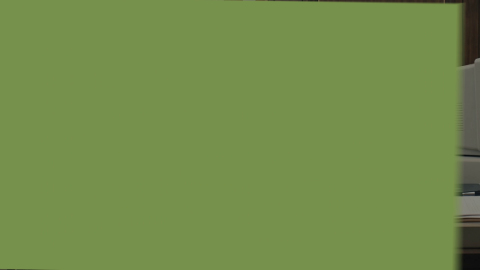 | **Wipes** Colour layers sweep across the cut. `solid_transition(look="Clean Wipe")` | `Clean Wipe` · `Diagonal Wipe` · `Vertical Drop` · `Soft Wipe` · `Gradient Wipe` |
| 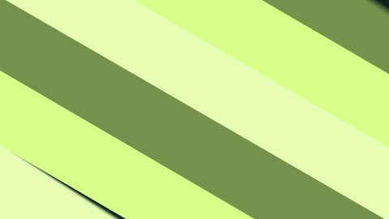 | **Bands** Bars, blinds, stacks and interleaved strips. `solid_transition(look="Slanted Bars")` | `Slanted Bars` · `Bar Cascade` · `Venetian Blinds` · `Shutter` · `Color Stack` · `Stack Rise` · `Zipper` · `Comb` |
| 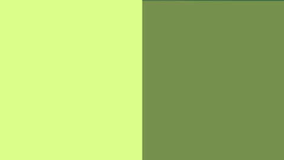 | **Splits** The frame opens from the middle. `solid_transition(look="Center Split")` | `Center Split` · `Horizon Split` |
| 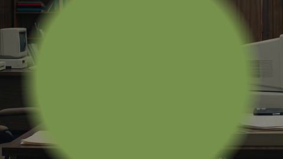 | **Iris and shapes** Circles, rings and diamonds grow from a point. `solid_transition(look="Iris Pop")` | `Iris Pop` · `Ring Burst` · `Corner Burst` · `Rainbow Rise` · `Diamond Reveal` |
| 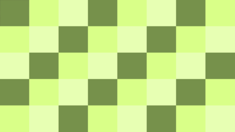 | **Grids and dots** Cells and dots fill the frame in an order. `solid_transition(look="Pixel Grid")` | `Pixel Grid` · `Grid Scatter` · `Grid Bloom` · `Dot Matrix` |
| 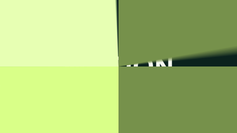 | **Fans** Pie slices sweep round a corner or the centre. `solid_transition(look="Fan Sweep")` | `Fan Sweep` · `Corner Fan` |
| 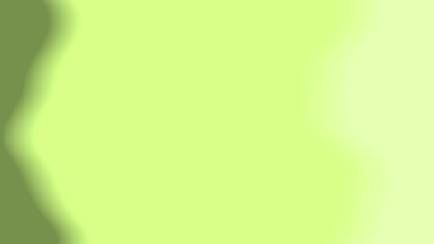 | **Liquid and ink** Living wavy edges and ink blooms. `solid_transition(look="Liquid Wipe")` | `Liquid Wipe` · `Liquid Rise` · `Ink Drop` · `Ink Corner` |
| 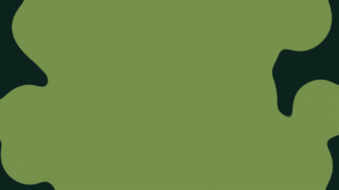 | **Bubbles** Bubbles that melt into each other cover the cut. `solid_transition(look="Bubble Wipe")` | `Bubble Wipe` · `Bubble Rise` |
| 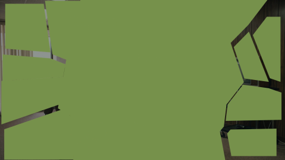 | **Shards** Voronoi shards break and sweep away. `solid_transition(look="Shatter")` | `Shatter` · `Shard Sweep` |

### Clip transitions (24)

| | Family | Variants (ask for them by name) |
|---|---|---|
| 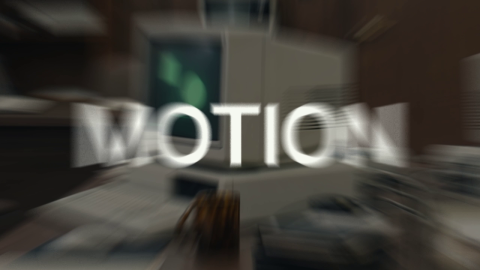 | **Zoom and spin** Shot to shot through a zoom, a spin, a roll or a twirl. `solid_transition(look="Zoom Through")` | `Zoom Through` · `Spin Through` · `Camera Roll` · `Twirl Zoom` |
| 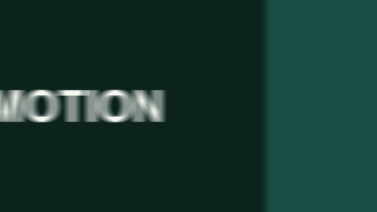 | **Slides** Push and whip from one shot to the next. `solid_transition(look="Whip Slide")` | `Whip Slide` · `Vertical Whip` · `Stretch Slide` |
| 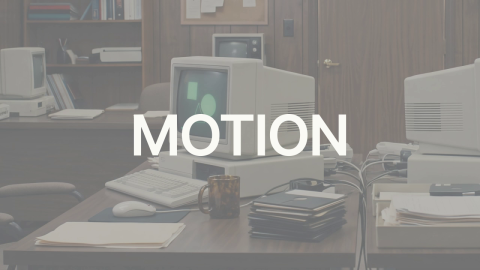 | **Flash and dip** A flash or a dip to a colour between shots. `solid_transition(look="Flash Cut")` | `Flash Cut` · `Dip to Black` |
| 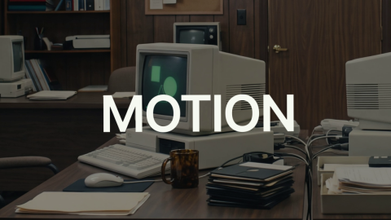 | **Shake, slices and glitch** Camera shake, sliced frames and an RGB glitch. `solid_transition(look="Camera Shake")` | `Camera Shake` · `Slice Cut` · `Glitch Cut` |
| 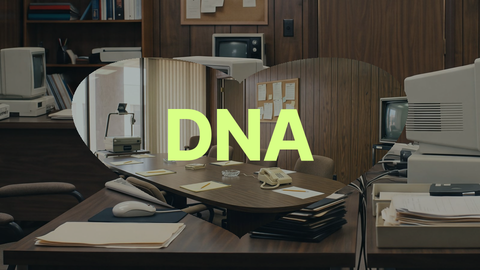 | **Shader wipes** Shapes, patterns and noise reveal the next shot (gl-transitions shaders as luma mattes; 73 in all with gl_transition). `gl_transition(name="HeartWipe", outgoing="…", incoming="…")` | `HeartWipe` · `StarWipe` · `FlowerWipe` · `Pinwheel` · `ClockWipe` · `PolkaDotsCurtain` · `Crosshatch` · `WindowBlinds` · `RadialWipe` · `PerlinDissolve` · `DoomMelt` · `UndulatingBurnOut` |

### Elements (30)

| | Family | Variants (ask for them by name) |
|---|---|---|
| 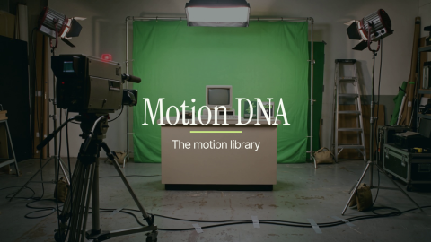 | **Titles** Titles that size themselves: plain, scaled, cinematic, kinetic, on tiles. `add_element(kind="title", …)` | `title` · `scale_title` · `cinematic` · `kinetic` · `tiles` |
| 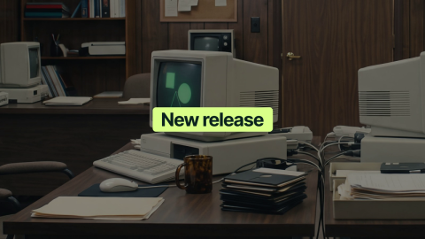 | **Labels and tags** Chips, handles, stickers, price tags and buttons. `add_element(kind="label", …)` | `label` · `handle` · `sticker` · `price_tag` · `button` |
| 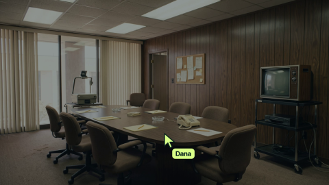 | **Cursors and selection** Named collaborator cursors that click on arcs, and a selection marquee dragged open. `add_element(kind="cursor", text="Dana", items=[[700, 400], [1200, 620]])` | `cursor` · `selection` |
| 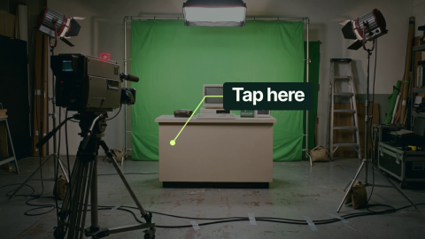 | **Callouts and chat** Pointers, speech bubbles and chat messages. `add_element(kind="callout", …)` | `callout` · `bubble` · `chat` |
| 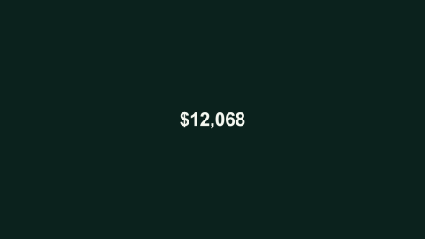 | **Data** Counters, timers, progress bars, rings and ratings. `add_element(kind="counter", …)` | `counter` · `timer` · `progress` · `ring` · `rating` |
|  | **Text blocks** Lower thirds, quotes, text boxes and lists. `add_element(kind="lower_third", …)` | `lower_third` · `quote` · `text_box` · `list` |
| 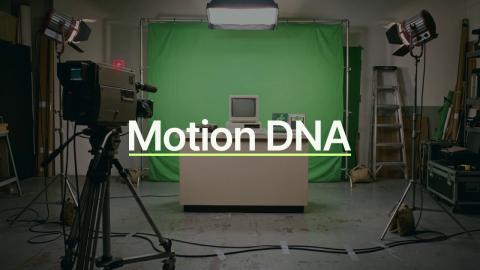 | **Marks on text** Underline or highlight an existing text layer. `add_element(kind="underline", …)` | `underline` · `highlight` · `scribble` |
| 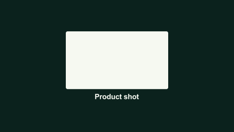 | **Media slot** A rounded slot that fits an image or a clip. `add_element(kind="media", …)` | `media` |
| 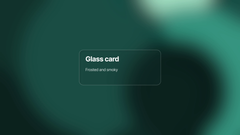 | **Glass card** A smoky frosted card over a moving background. `add_element(kind="glass_card", text=…, sub=…)` | `glass_card` |
|  | **Logo close** Our logo built stroke by stroke (Motion DNA videos only). `add_element(kind="end_card", text="Motion DNA", sub=tagline, style="horizontal"?)` | `end_card` |

### Shapes (42)

| | Family | Variants (ask for them by name) |
|---|---|---|
| 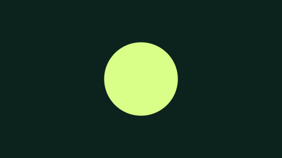 | **Primitives** Circles, polygons, stars, badges, hearts, checks. `add_shape(kind="circle", …)` | `circle` · `ring` · `square` · `frame` · `triangle` · `diamond` · `pentagon` · `hexagon` · `star` · `sparkle` · `badge` · `heart` · `shield` · `cross` · `plus` · `check` |
| 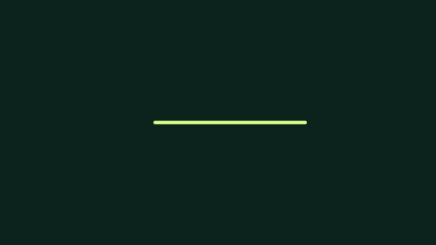 | **Lines and arrows** Lines that draw on and travel off: waves, arrows, brackets, spirals, brush strokes. `add_shape(kind="line", …)` | `line` · `wave` · `zigzag` · `arrow` · `curved_arrow` · `chevrons` · `brackets` · `spiral` · `infinity` · `brush` · `speed_lines` |
| 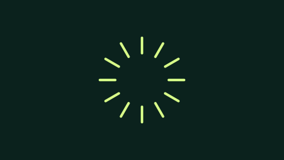 | **Bursts** Impacts, shockwave rings, pops, fireworks, confetti and swooshes. `add_shape(kind="burst", …)` | `burst` · `impact` · `rings` · `pops` · `fireworks` · `confetti` · `swoosh` · `particle fireworks` · `confetti cannons` · `sparks` |
| 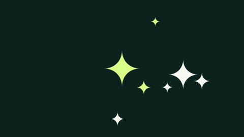 | **Sparkles** Four-point sparkles that pop, twinkle and fade. `add_shape(kind="glitter", …)` | `glitter` |
| 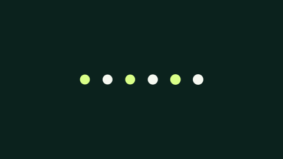 | **Rows and loaders** Rows of shapes, dot rows and a loader. `add_shape(kind="shape_row", …)` | `shape_row` · `dots` · `loader` |
| 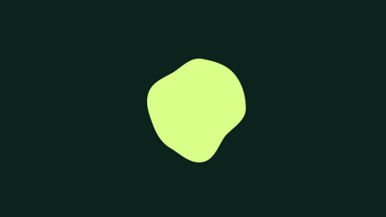 | **Blob** A liquid blob that keeps breathing. `add_shape(kind="blob", …)` | `blob` |

### Backgrounds (12)

| | Family | Variants (ask for them by name) |
|---|---|---|
| 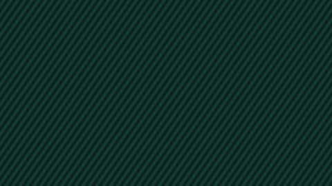 | **Patterns** Stripes, dots, grids and topographic lines. `add_look(kind="stripes", …)` | `stripes` · `dots` · `grid` · `topo` |
|  | **Gradients** Moving gradients: four-colour, liquid and mesh. `add_look(kind="gradient", …)` | `gradient` · `liquid` · `mesh` · `living gradient` |
| 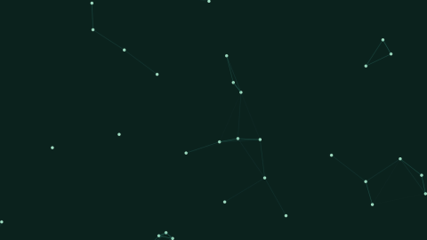 | **Organic** A plexus network, breathing blobs and frosted glass. `add_look(kind="network", …)` | `network` · `blobs` · `glass` · `flow field` |

### Looks (11)

| | Family | Variants (ask for them by name) |
|---|---|---|
| 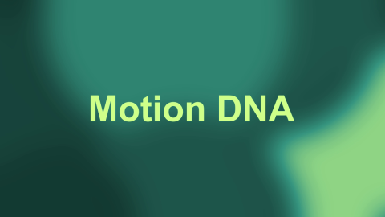 | **Colour** Tritone and duotone grades. `add_look(kind="tritone", …)` | `tritone` · `duotone` |
| 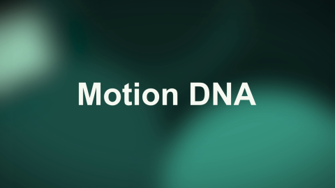 | **Frames** Vignette and letterbox. `add_look(kind="vignette", …)` | `vignette` · `letterbox` |
| 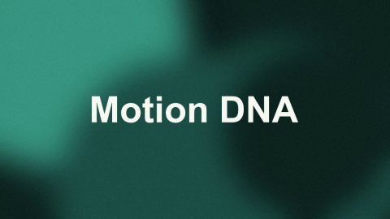 | **Texture** Grain and scanlines. `add_look(kind="grain", …)` | `grain` · `scanlines` |
| 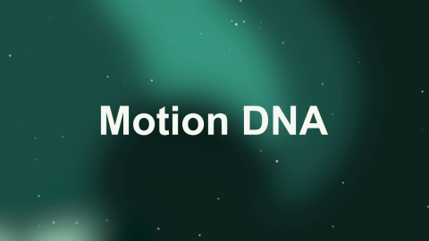 | **Particles** Dust, embers and snow. `add_look(kind="dust", …)` | `dust` · `embers` · `snow` |
| 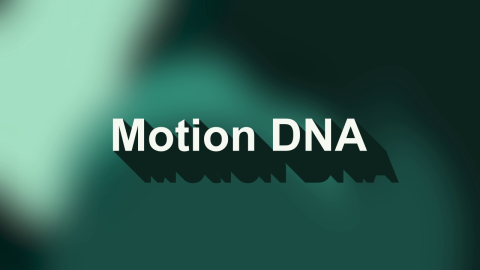 | **Long shadow** A long flat shadow behind a layer. `add_look(kind="long_shadow", …)` | `long_shadow` |
| 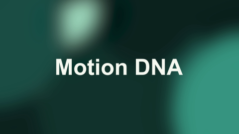 | **Glitch** An RGB glitch burst on a layer. `add_look(kind="glitch", …)` | `glitch` |

### Text engine (11)

| | Family | Variants (ask for them by name) |
|---|---|---|
| 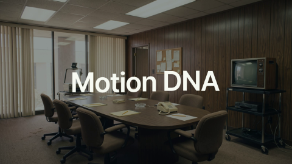 | **Reveals** Per character, word or line: rise, mask, tracking, skew. `animate_text(unit="chars", channels=["fade","rise"], ease="Pop")` | `Chars Pop Rise` · `Lines Mask Rise` · `Words Tracking Blur` · `Chars Skew Slide` |
| 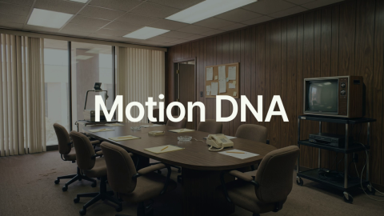 | **Playful** 3D flips, wiggly scale and colour pops. `animate_text(unit="chars", channels=["rotate3d","fade"], order="center", ease="Nudge")` | `Chars 3D Flip` · `Chars Wiggly Scale` · `Words Colour Pop` |
| 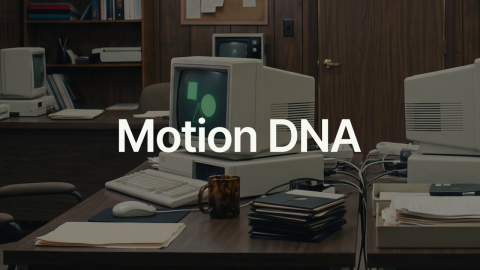 | **Typing** Decode, a typewriter with its cursor and a font swap. `animate_text(unit="words", channels=["decode","fade"], mode="flicker")` | `Words Decode` · `Typewriter Cursor` · `Font Swap` |
| 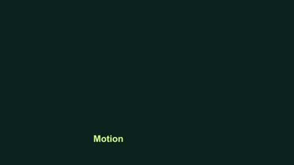 | **Captions** Word-timed captions: highlight, karaoke, build, pop. `add_captions(words_path=…, style="highlight")` | `Captions` |

### Moves (25)

| | Family | Variants (ask for them by name) |
|---|---|---|
|  | **Flips and hinges** 3D entrances that turn in. `move(move="flip", layers=[…])` | `flip` · `hinge` · `tumble` |
|  | **Fly and orbit** Travel in from depth or around a pivot. `move(move="fly", layers=[…])` | `fly` · `orbit` |
| 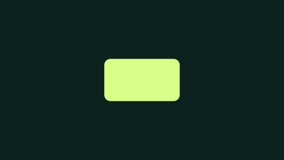 | **Grow and squash** Grow from an edge, squash and stretch. `move(move="grow_edge", layers=[…])` | `grow_edge` · `squash` |
| 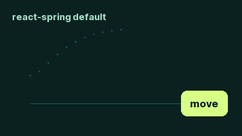 | **Springs and eases** Real springs, wobble, elastic and bounce from react-spring and anime.js, on any keyed move (apply_spring). `apply_spring(name="react-spring default", layers=[…])` | `react-spring default` · `react-spring gentle` · `react-spring wobbly` · `react-spring stiff` · `react-spring slow` · `react-spring molasses` · `anime spring default` · `anime spring bounce 0 · 500 ms` · `anime spring bounce 0.25 · 600 ms` · `anime spring bounce 0.5 · 628 ms` · `anime spring bounce 0.7 · 800 ms` · `anime outBack` · `anime outElastic` · `anime outBounce` · `anime outExpo` · `anime inOutCirc` |
| 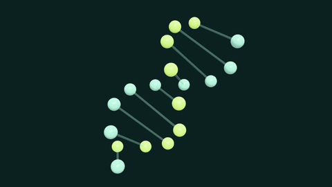 | **3D scenes** Rendered 3D with alpha: the DNA helix or a product turntable (three.js), shapes that rain and pile up (Rapier). `add_fx(kind="helix 3d", …)` | `helix 3d` · `drop 3d` |

### Behaviours (12)

| | Family | Variants (ask for them by name) |
|---|---|---|
| 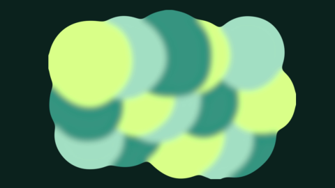 | **Fill** Bubbles, blob, voronoi cells and growth fill an area. `add_behavior(behavior="bubbles", target="shape", …)` | `bubbles` · `blob` · `voronoi` · `grow` |
| 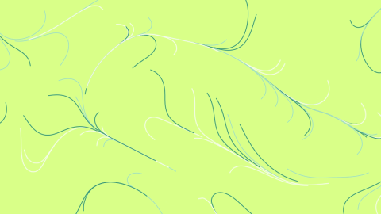 | **Swarm** Flow fields and flocks move in a loop. `add_behavior(behavior="flow", target="background", …)` | `flow` · `flock` |
| 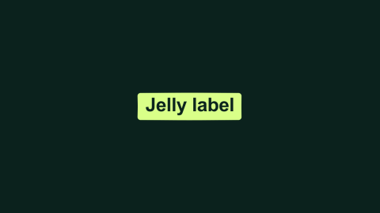 | **Physics** Springs and ropes react to the curve. `add_behavior(behavior="spring", target="box", …)` | `spring` · `rope` · `fall` · `drop in` · `burst` |
| 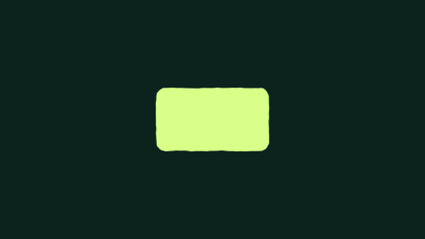 | **Modifier** Line boil: any layer drawn on 3s. `add_behavior(behavior="line_boil", target="layer", …)` | `line_boil` |
<!-- catalog:end -->
