# Animation Composer → Motion DNA map

Animation Composer (Mister Horse) is a **behavioral reference only**. We never decrypt, unpack or ship its presets
(`.mhitemdata`, `.mhprodmeta`). This map comes from three sources:

- watching its preview videos (`research/analysis/product_*.json`: about 6,100 previews measured by `tools/analyze_previews.py`, plus contact sheets made from them);
- its public catalog (`research/ac_catalog/public_tree.json`, local and git-ignored: every pack's category tree, crawled from misterhorse.com);
- using its helper panels.

Motion DNA rebuilds the *behavior* from scratch as code Claude drives in the background, keyed with our own tokens: the same curves (Surge, Pop, Whip…) and durations (Arrive, Sweep, Stage…) as every preset.

## 1. What AC ships, measured

On the previews installed here:

| AC product | Previews | Median phase | Overshoot | Dominant curves | Dominant channels |
|---|---:|---:|---:|---|---|
| Text (42) | 1,416 | 801 ms | 38 % | Pop, Flat, Launch | position, fade, blur, scale, warp |
| Element / Logo (43) | 1,908 | 601 ms | 47 % | Pop, Launch, Flat | fade, scale, position, warp, blur |
| Shapes & lines (3260, 3297) | 922 | 701 ms | 67 % | Pop | fade, scale, rotate |
| Footage transitions (3266) | 869 | 434 ms | 81 % | Pop | blur, fade, rotate, position, scale |
| Titles & callouts (3283) | 339 | 267 ms | 66 % | Pop | fade, scale, blur, warp |
| Mixed (3300) | 469 | 434 ms | 58 % | Pop | fade, scale, blur, position |
| Flat 2D transitions (2014) | 190 | 601 ms | 86 % | Pop | blur, fade, rotate, scale |

AC's look is short phases with overshoot (Pop), blur on almost every move and warp on a third of the elements.
Transitions are the snappiest and overshoot the most.

## 2. Every AC family and what Motion DNA builds for it

| AC family (public catalog) | Items | Motion DNA | How to call it |
|---|---:|---|---|
| Motion presets: 2D transitions (fade, position, scale from anchor/edge, rotate, blur, warp) | ~870 | 49 motion presets + token curves; grow from edge and one-axis squash | `apply_preset`, `move` (grow_edge, squash) |
| Motion presets: 3D transitions (card flip, hinge on edge, orbit round a distant pivot, Z fly, tumble) | 1,018 | Parametric 3D moves on token curves | `move` (flip, hinge, orbit, fly, tumble) |
| Motion presets: effects (loops: bob, wiggle, rock, jelly, bounce) | 82 | 11 FX loops (Float, Pulse, Jitter, Swing, Boil…) | `apply_preset` (fx) |
| Text presets: characters / words / lines × fade, position, scale, rotate, skew, tracking, blur, decode, colour, mask, 3D, typewrite; ease, overshoot, flicker, wiggly | 1,414 | Text engine with token curves solved per unit (Pop overshoots per letter), flicker/wiggly modes, mask reveal, decode, 3D per char, colour, typewriter with cursor; 11 TX presets | `animate_text`, `apply_preset` (text) |
| Shape elements: glitter, lines, lines of shapes, shape pops, smoke puffs, swooshes, impacts, trails, fireworks, brushes, arrows, circles, crosses, ornamental, stars, triangles, diamonds, rectangles, badges | 922 | 39 shapes: primitives, lines that draw on and travel off, marks, impacts (spread/mirror), particle pops, shape row, fireworks, glitter, shockwave rings, swoosh echoes, brush, confetti | `add_shape` |
| Shape transitions (rectangles, arrows, blinds, circles, stripes, rainbows, rows, zippers, gradients, grids, dots) | 190 | 9 solid/mask types + dots, fan, origin (corner/bottom), gradient fill; 25 named looks | `solid_transition` |
| Transitions for footage (light leaks, glitch, camera pan/zoom/roll/rotate/shake, shapes, split, blurs and fades, matte) | 468 | Clip to clip: zoom (radial blur), spin/roll, stretch, slide (push), flash, dip, shake, twirl, slices, glitch; 13 named looks | `solid_transition` (clip types) |
| Essential typography / titles & callouts (text boxes fill/outline/rounded, callouts, long text, lower thirds, media placeholder, quotes, social) | 799 + 339 | 27 self-sizing elements incl. glass card, outline boxes, text box, media slot, quote, handle, bubble, callout, lower third | `add_element` |
| Scale titles (push / drop, bubble, callouts, placeholder) | 184 | scale_title (push/drop), bubble, callout | `add_element` |
| 3D titles (zoom, scale character, rotation, kerning, drop) | 360 | Text engine 3D per char + moves on title layers | `animate_text` (rotate3d), `move` |
| Cinematic titles (neon, position, blur, fractal, kerning, deformation, scale character, light mask) | 169 | cinematic: neon, blur, kerning; text engine for the rest | `add_element` (cinematic), `animate_text` |
| Social media (platform lower thirds, icons, buttons, chat elements) | 156 | handle pill, button with cursor click, chat with typing dots, heart/check shapes; **no platform logos** (CLAUDE.md) | `add_element`, `add_shape` |
| Timers & counters (digital, progress rings/bars, rating, universal counters) | 84 | counter, timer, progress bar, ring, rating | `add_element` |
| Automatic captions (word by word, highlight, background, styled) | 131 | Captions from word timings or SRT: highlight, karaoke, build, pop, word; box and outline | `add_captions` |
| Backgrounds (flow, geometric, gradient, liquid, pattern, shape, texture, typography) | 313 + 489 | stripes, dots, grid, gradient, liquid, topo, network (plexus: points joined by lines that fade with distance), blobs, mesh gradient, frosted glass panes; glass card element (procedural, brand colours) | `add_look` |
| Overlays (VHS, film burns, 8mm, particles, light leaks, scratches, duotone/tritone, frames, effects, grain, vignettes, lights) | 263 | Generated: tritone, duotone, vignette, grain, scanlines, letterbox, dust, embers, snow. Footage (light leaks, burns, VHS): the licensed packs indexed locally + CC0 VFX | `add_look`, `add_asset` |
| 2D special effects (cel fire, electric, energy, smoke, sparks, explosions…) | 500 | Realistic CC0 sequences (Unity Labs: fire, smoke, explosions) + shapes (impact, fireworks) | `add_asset` (vfx), `add_shape` |
| Animated textures (material mattes, grunge, brushes) | 720 | Not rebuilt: CC0 textures listed (ambientCG, Poly Haven) | `list_resources` |
| Essential sound effects (37 categories) | 1,000 | Licensed packs indexed locally + 525 CC0 SFX (Kenney) + 85 CC0 jingles + 12 CC0 music tracks | `add_asset` (sfx, music) |
| Helper tools: Keyframe Wingman, Keyframe Actions, Anchor Point Mover, Transition Shifter | — | ease (token on every segment), copy_ease, reverse, mirror_out, stagger (incl. random), randomize, shift, to_playhead, sequence, distribute, loop, bake, stretch, copy_to, anchor_point | `keyframes`, `anchor_point` |

**Not rebuilt, by decision:**

- **Frame-by-frame drawn assets:** animated fonts, icon and illustration packs, hand-drawn stuff. These are drawn content, not behavior.
- **Panel-only features:** the browser, user library and sound pitch/reverse.
- **Premiere-only products.**

## 3. Quality review against AC (2026-10-14)

Each family was rendered as 8-frame strips next to strips of AC previews of the same kind:

- **Elements, the text engine, moves and captions** hold up next to AC's basic titles and presets.
- **Lines and shapes were too mechanical.** Lines now draw on, hold and *travel off* (the trim start chases the end) with a breathing stroke. Rings became a shockwave, pops became particles and swooshes became colour echoes.
- **Flat transitions were flat.** They now use a tonal palette (one hue in three shades, as AC does) with a slight swing and motion blur. The clip zoom uses a radial zoom blur instead of a soft gaussian.

**Retired:** the cartoon smoke puff, the generated light leak (use real footage) and the cinematic light sweep. Each looked clearly worse than AC, so Claude no longer offers them.

## 4. Samples

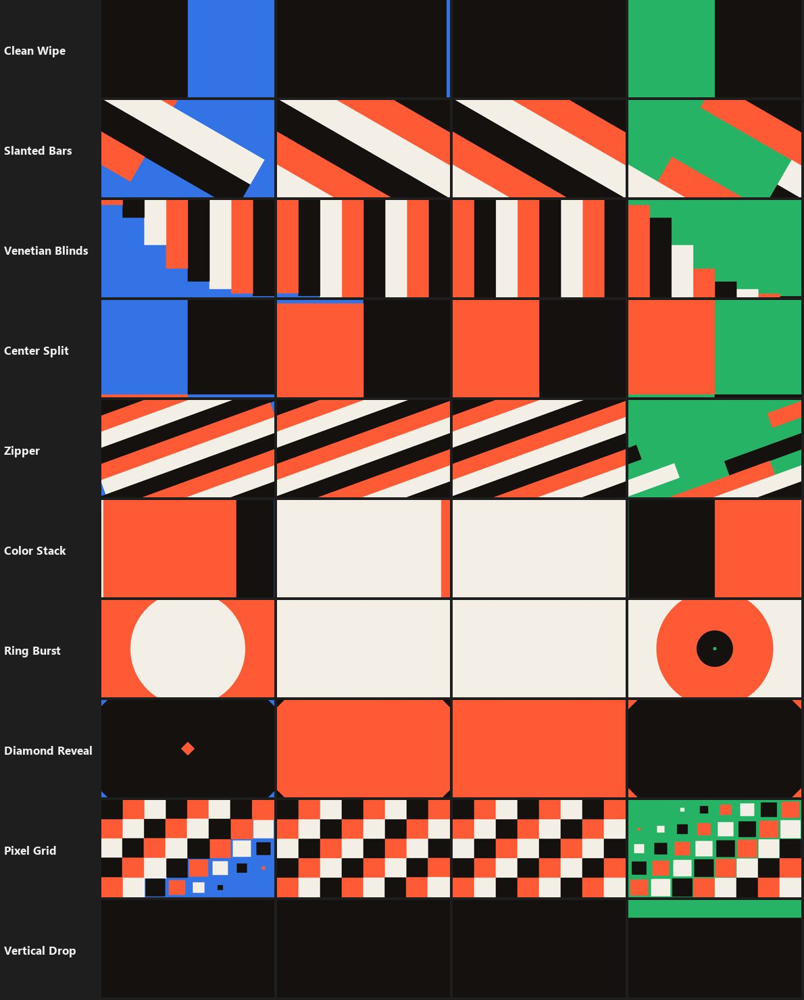

| | |
|---|---|
| 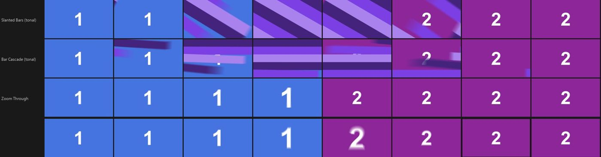 | 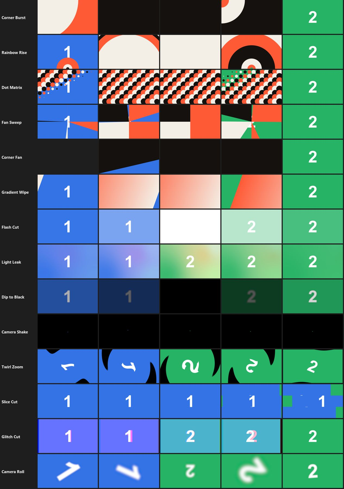 |
| 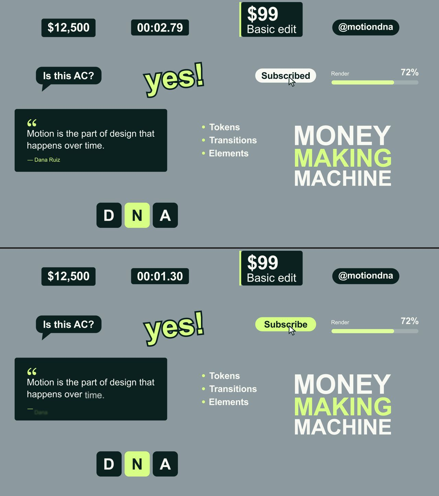 | 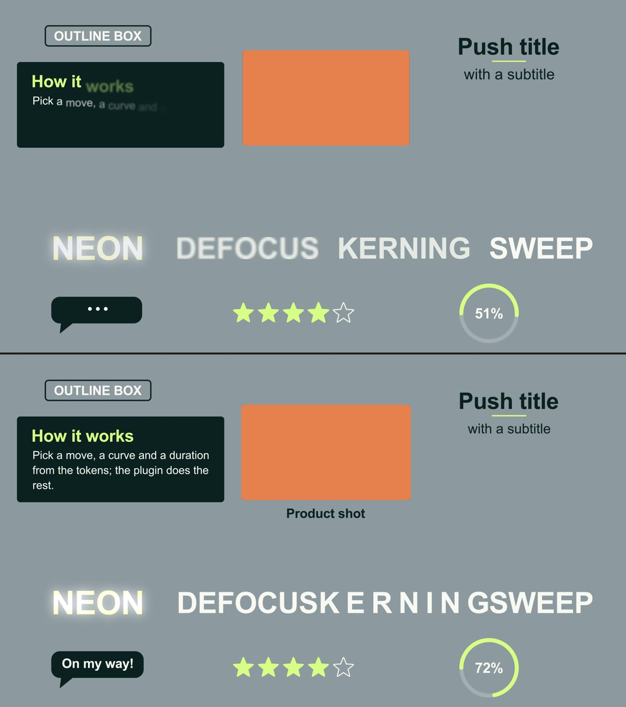 |
| 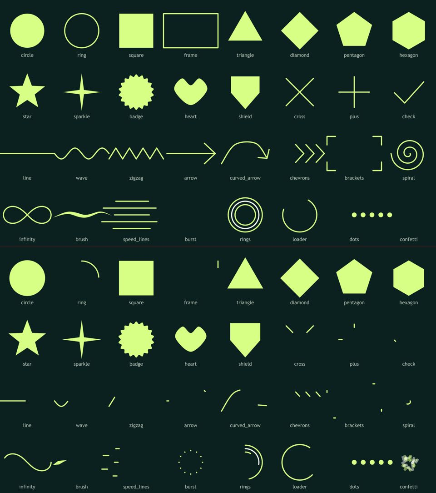 | 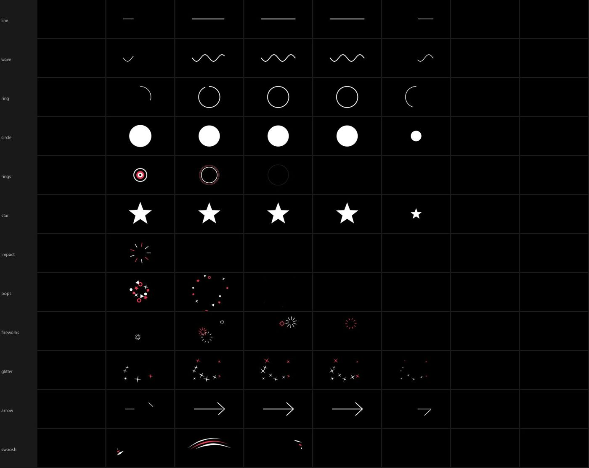 |
| 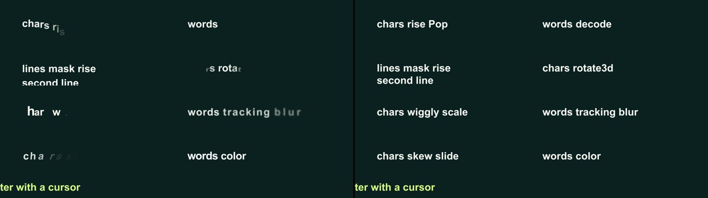 | 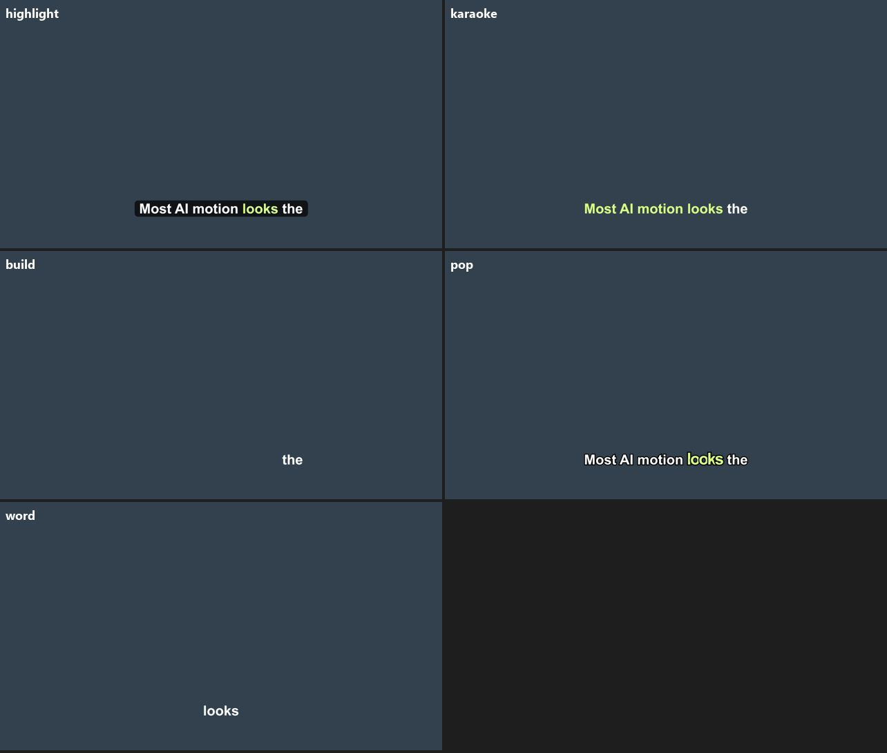 |
| 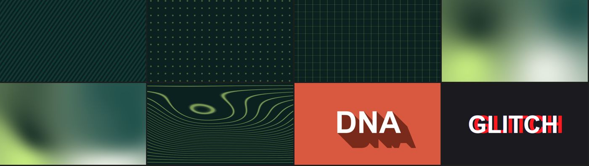 | 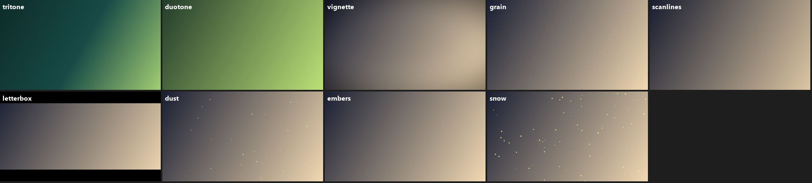 |
