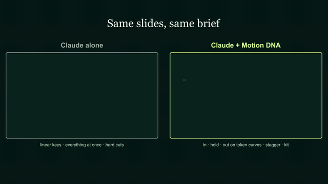
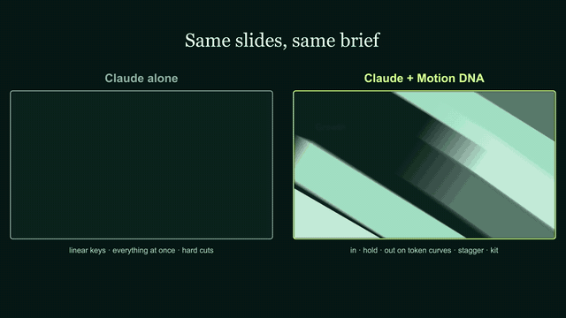
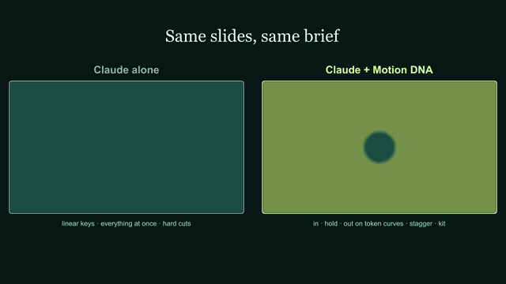

# Case study: *Claude alone vs Claude + Motion DNA* (24 s · what the library adds to an LLM's animation)

The same six deck slides, the same brief, animated twice side by side. On the left, the way an LLM animates in After
Effects on its own: linear keyframes, every layer fading in at the same moment, a static hold and a hard cut. On the
right, the same slides with Motion DNA: token curves with acceleration and deceleration, every slide with an entrance, a
living hold and an exit, staggered pieces, kit elements and kit transitions. It proves the point of the library in one
look, and it set the rule that a hold must never be static. Final video:
[`docs/examples/claude-vs-motion-dna.mp4`](../examples/claude-vs-motion-dna.mp4).

| Title | Numbers | Timeline |
|---|---|---|
|  |  |  |

## Brief
"A comparison without our plugin and with it, to see why the normal animation Claude makes is one thing and with our
plugin it comes alive: slides Claude would animate on its own, animated much better with the plugin, so the difference
shows." After the first cut: less static, more rhythm, more curves, longer, and no sparkles.

## What differs, slide by slide
| Slide | Claude alone | Claude + Motion DNA |
|---|---|---|
| Title | everything fades up together, 1 s linear | kicker blurs in by character (Cruise), title rises per character with blur (Settle, Sweep), subtitle by word, an accent line draws on; the title floats |
| Agenda | three lines fade together | heading per character, items slide in by word 0.16 s apart (Land), a marker pops in (Settle) |
| Numbers | static "+38%", bars scale linearly together | the counter counts up, a label chip grows, bars grow from the base 0.1 s apart with overshoot (Pop) |
| Timeline | everything fades together | the track draws (Surge), dots pop in 0.22 s apart (Pop), labels rise, the last dot breathes |
| Quote | fades together | words rise with blur (Sweep), the author tracks in (Cruise), the quote drifts |
| Close | fades together | lines rise; a button is clicked by the cursor and changes state |
| Every slide | holds still, hard cut | slow camera push (100 → 103.5 %), a staggered exit on Launch before the cut, a different kit transition per cut (Liquid Wipe, Slanted Bars, Iris Pop, Color Stack, Ink Drop) |

## Added to the library
- `tools/build_compare.jsx`: rebuilds the comparison (both decks, the split screen, the logo close).
- The rule *in · hold · out*: every scene needs an entrance, a living hold and an exit (recorded in `docs/LEARNINGS.md`).
- `glitter` rebuilt after this review: four-point sparkles with concave sides, one hero and a few small ones, each with
  its own pop, twinkle and fade (the thin spinning crosses looked cheap).

## Steps (reproducible)
| # | Step | Tool / file |
|---|---|---|
| 1 | Build both decks, the split screen and the close | `bash tools/bridge.sh tools/build_compare.jsx` (or MCP `run_jsx`) |
| 2 | Render | MCP `render_comp` on `MDNA Compare` |
| 3 | Example video and GIFs | `ffmpeg` (1280 px H.264; GIFs at 12 fps, 640 px) |

## What went wrong first (and the fix)
- The first cut (3 slides) read as static on the Motion DNA side too: elements arrived and then stood still until a hard
  cut → every slide got a slow camera push, floating heroes and staggered exits on Launch before the cut.
- The counter's exit counted back down and left a blurred blob → the counter keeps its value; the transition covers it.
- Sparkles (`glitter`) looked cheap next to the rest → rebuilt (see above) and kept out of the cut.

All names and numbers on screen are fictional. The fonts in this render are the fallbacks (Georgia / Arial) because After
Effects on the build machine did not see the brand fonts (see `docs/LEARNINGS.md`).
