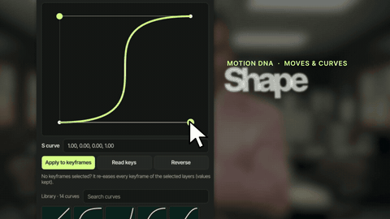
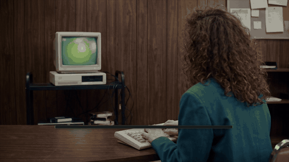
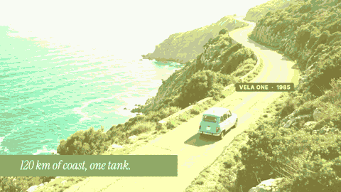

# Case study: *Motion DNA teaser* (102 s · a 1985 TV ad for the plugin, built with the plugin)

The plugin's own teaser: AI-generated plates and characters, a Figma storyboard rebuilt in After Effects as live layers,
UI scenes that show the tool doing what the voice says, word-timed supers, tracked labels and a spot that the "agent"
builds on screen. Eleven review rounds turned into a QA tool (`tools/qa_hidden.jsx`), a project collector
(`tools/collect_project.jsx`) and rules 16-24 of CONTRIBUTING §9. Final video:
[`docs/examples/motion-dna-teaser.mp4`](../examples/motion-dna-teaser.mp4) (720p preview).

| The curve follows the cursor | "Just ask" | The spot the agent built |
|---|---|---|
|  |  |  |

## Brief
A teaser for Motion DNA in the voice of a 1985 TV commercial: an animator (Dana) tired of making the same animation
every time, a salesman (Rex Valance) who brings the plugin; show moves and curves, brand guidelines and agent mode
(a Figma storyboard becomes an After Effects spot), close on the boxed product and the logo. New fictional characters,
no real brands, full motion, every UI shot built from the real panel components, not screenshots.

## Added to the library
- `tools/qa_hidden.jsx`: hidden-layer QA before a render (overlays under opaque plates, footage shorter than its layer
  by half a frame, disabled or never-visible overlays), nested comps included.
- `tools/collect_project.jsx`: a scriptable *Collect Files* that keeps repo-relative paths, for handoff folders.
- CONTRIBUTING §9 rules 16-24 (word-timed supers, UI text blocks, plates that outlast their layer, camera on the UI
  action, a chat composer for typed requests, callouts on product details, words behind people, overlays inside their
  shot, labels above their sticker) and the "Before every render" checklist in `CLAUDE.md`.
- `tools/build_figma_slides.jsx`: Inter → Inter Tight mapping and whole tracking units.

## Steps (reproducible)
| # | Step | Tool / file |
|---|---|---|
| 1 | Script and review notes | `media/motion_dna_teaser/script_v8.md` |
| 2 | Character, location and prop sheets, then every plate from them | Flora (Seedance r2v with references), fal Kling 2.5 / v3 |
| 3 | Voices: one per character (speech-to-speech to a reference), lip-sync where needed | fal chatterbox, sync-lipsync v2; whisper word times |
| 4 | Storyboard and UI screens in Figma, dumped to JSON | Figma *motion-adn* › 06; `tools/_teaser_spec_v6.py` |
| 5 | UI rebuilt as AE layers, then animated with the plugin | `tools/build_figma_slides.jsx`, `tools/_build_teaser_v6.jsx`, `_animate_teaser_v6*.jsx`, `_build_u1_v8.jsx`, `_build_u2_v8.jsx` |
| 6 | Tracking (car, floppy, robot, CRT glass) | OpenCV template matching, nulls + `toComp` expressions |
| 7 | Edit as data (shots, supers, callouts, VO gains, music ducking) | `tools/_assemble_teaser_v6.jsx` (`E`, `BIG`, `CO`, `VO`) |
| 8 | QA, render, loudness, black frames | `qa_hidden.jsx`, `check_layout`, `render_frame`, ebur128, `blackdetect d=0.03` |
| 9 | Storyboard of the final and a handoff folder | Figma node `68:4303`; `tools/collect_project.jsx` |

The temporary build scripts (`tools/_*`) are git-ignored; the handoff folder (`media/motion_dna_teaser/handoff_v11/`,
local, not in git) carries them with the collected project, the footage and a `HANDOFF.md`.

## Costs (USD)
| Item | Count | Cost |
|---|---|---|
| Kling 2.5 turbo pro i2v (plates, car clips) | ~12 clips | ≈ 4.2 |
| Kling v3 pro i2v with audio (YES) | 1 | 0.56 |
| Speech-to-speech, lip-sync, SFX, music | — | ≈ 1.4 |
| Background removal (YES cut-out) | 2.2 s | 0.11 |
Flora generations and the rejected attempts (MiniMax H3, Kling 2.6, O3) are in `docs/LEARNINGS.md` §8.

## What went wrong first (and the fix)
Every item is in `docs/LEARNINGS.md` (review rounds v9, v10, v11 and the teaser entries in §1, §3, §4, §5). The ones
that cost the most rounds:
- UI shown as screenshots fading in → UI as live layers, a cursor that hovers, clicks and drags, the result happening.
- A nested comp on its own clock (the curve moved before the cursor) → key nested animation on the nested time.
- Plates and generated clips that end early or in black → `qa_hidden.jsx` + `blackdetect` on sources and the master.
- Supers typed as sentences, side text too small → one word per spoken beat, two-line blocks, `Words Slam`.
- A playhead that scrubbed the spot back and forth → play forward, cut on the spot's own wipes.

All prices, brands and names on screen are fictional; the characters are AI-generated.
