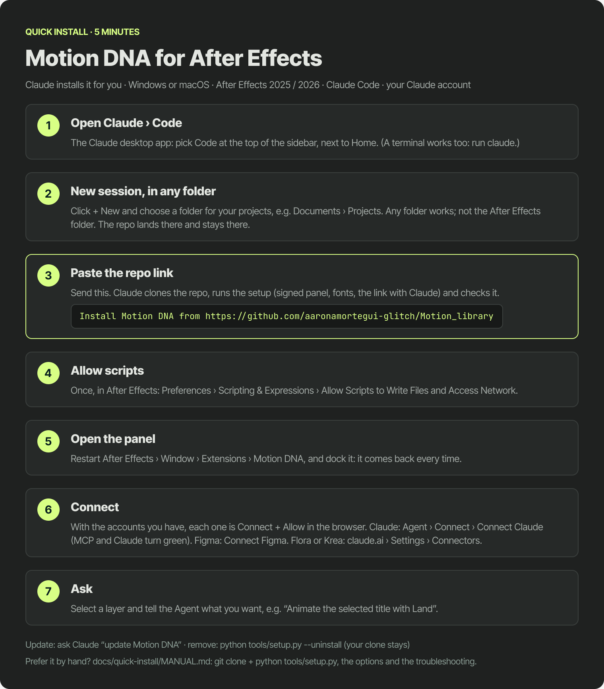

# Install Motion DNA with Claude Code (quick install)

The easy way: Claude installs it for you. About five minutes. Prefer doing it by hand? See [MANUAL.md](MANUAL.md).

**You need:** Windows or macOS · After Effects 2025 or 2026 · [Claude Code](https://claude.com/claude-code) (the desktop
app or a terminal) · your Claude account. Optional: Figma, and Krea or Flora if you want to generate images and video.

Video (about 75 s, Rex explains it): `media/motion_dna_tutorial/video/tutorial_install.mp4`.
The guide in Figma: *motion-adn* › page **07 · Quick install** (built from the panel components).

## 1. Open Claude › Code
Open the Claude desktop app and pick **Code** at the top of the sidebar (next to Home). A terminal works too: run
`claude`.

## 2. New session, in any folder
Click **+ New** and choose a folder for your projects, e.g. *Documents › Projects*. **Any folder works**; do not pick
the After Effects folder (it belongs to Adobe and may need admin rights). Claude clones the repo into the folder you
choose, and it must stay there: the panel reads the library from it. `setup.py` finds every After Effects version on
its own and installs the panel in each one.

## 3. Paste the repo link
Type this and send it:

```
Install Motion DNA from https://github.com/aaronamortegui-glitch/Motion_library
```

Claude clones the repo, runs `python tools/setup.py` (signed panel, fonts, the link with Claude, the startup bridge)
and checks it. It ends by telling you the two things only you can do in After Effects: steps 4 and 5.

## 4. Allow scripts (once)
After Effects › *Preferences › Scripting & Expressions* › tick **Allow Scripts to Write Files and Access Network**.

## 5. Open the panel
Restart After Effects › *Window › Extensions › Motion DNA*, and dock it: it comes back every time you open After Effects.

## 6. Connect: Claude, Figma, Krea or Flora
With the accounts you already have, each one is a button and an **Allow** in your browser:
- **Claude:** in the panel, *Project › Connect › Connect Claude*, sign in once. The **MCP** and **Claude** dots turn green.
- **Figma** (optional): *Connect Figma* in the same sheet, then **Allow** in the Figma page that opens.
- **Flora / Krea** (optional, to generate images and video): claude.ai › *Settings › Connectors* › Flora or Krea ›
  **Connect**, then **Allow**. In Claude Code you can also ask: *"connect Krea as an MCP"* (it runs
  `claude mcp add --transport http krea https://api.krea.ai/mcp` and opens the sign-in).

## 7. Ask
Select a layer and tell the Agent what you want, e.g. *"Animate the selected title with Land"*.

**Update:** *Project › Connect › Update* in the panel (it shows "Update available (N new)" when GitHub has new commits),
or ask Claude *"update Motion DNA"*. Both run `python tools/setup.py --update`, which never touches your local changes;
then *Reload panel*. **Codex** (optional): the same sheet signs you in to Codex and adds the Motion DNA tools to it.
**Remove:** `python tools/setup.py --uninstall` (your clone stays).


