# Use cases: every tool, tested on real-looking work

We ran each Motion DNA tool, technique and style on a small, realistic piece from five industries, with fictional brands and generated
assets. The aim was to find what breaks or confuses a designer. Every finding below was fixed and re-tested. The
[User guide](../USER_GUIDE.md) turns these results into instructions and tips.

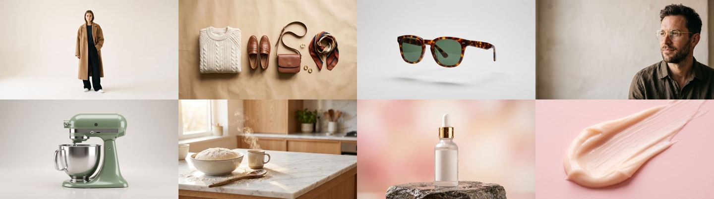

Assets: Nano Banana 2.1 on Flora, 2K, 8 images for USD 0.42. Cut-outs: the local `matte` tool (InSPyReNet).
Brands: Maison Nord (fashion), Oku Optics (eyewear), Lumé (beauty), Orto (kitchen) and Vela (cars). All fictional.

| # | Industry | Tool | Result | Findings (all fixed) |
|---|---|---|---|---|
| UC01 | Fashion | Behaviors · Create | OK | F1 |
| UC02 | Eyewear | Behaviors · Modify / Replace | OK | F2 |
| UC03 | Beauty | Text presets | OK | — |
| UC04 | Kitchen | Loops and transitions | OK | F3 |
| UC05 | Cars | Curves | OK | — (layout redesigned) |
| UC06 | Beauty | Brands: create, apply, share | OK | F4, F5, F6 |
| UC06b | Beauty | Agent: a review note becomes a rule | OK | — |
| UC07 | Fashion | Agent: a style from the Library | OK | F7 |
| UC08 | Fashion | Agent: text behind a person | Works, slow | F8, F9, F10, F11 |
| UC09 | Cars | Agent: Figma frame → After Effects | OK | F12, F13, F14 |
| UC10 | All | Projects and conversations | OK | — |
| UC11 | All | MCP directly (27/27, every tool) + layout QA | OK | QA false positives fixed |
| UC12 | Cars | Technique: tracked labels + HUD | OK | F18, F19 |
| UC13 | Cars | Technique: speed ramp | OK | — |
| UC14 | Eyewear | The 9 styles on one layout | OK | F21, F22 |
| UC15 | Fashion | Techniques: text behind (video), contour, roto breakdown | OK | F23 |
| UC16 | Fashion | Technique: freeze frame + kinetic type | OK | — |
| UC17 | Kitchen | Technique: shape wipe | OK | F20 |
| UC18 | Beauty | Technique: marker timing | OK | — |
| UC19 | Cars | Technique: cut on the voice | OK | — |
| UC20 | Eyewear | A brand that learns: v1 → v2 → v3 | OK | F24 |
| — | Panel | Reviews by Aaron and Gian | — | F15, F16, F17 |

Agent costs are Claude Code's own estimates. With a subscription they are not billed per order.

---

## UC01 · Fashion · Behaviors › Create
**Brief:** a campaign post for *The Coat Edit*: a title, the season, a call to action and the model.
**Steps:** select the four layers in reading order, then Behaviors › Moves › Slide Land › **Create**.

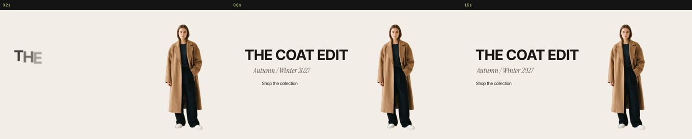

- **Worked:** "Slide Land: 4 animated". The stagger follows the order the layers were selected.
- **F1:** a text preset applied over a move replaced the move. A designer expects the two to combine: one moves the
  layer, the other moves the letters.
  **Fix:** Replace works channel by channel (`SSP.replaceWith`); whatever the new preset does not animate keeps its keys.

## UC02 · Eyewear · Modify and Replace
**Brief:** a product shot that already had a hand-made linear move, as a client file usually does.

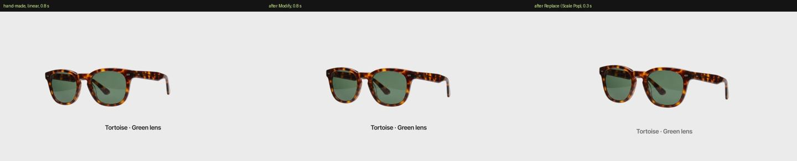

- **Modify:** the keyframe values stayed and the move got the preset's timing and curve. Frame 2 shows the same pose,
  now eased.
- **Replace:** the move was swapped for Scale Pop (frame 3).
- **F2:** Replace also deleted the layer's own rotation, which Scale Pop does not use.
  **Fix:** the same channel-by-channel replace.
  The panel now says *replaced* (your own animation) or *redone* (an earlier Motion DNA move).

## UC03 · Beauty · Text presets
**Brief:** a serum ad with a headline, a claim and a price over a cream texture.

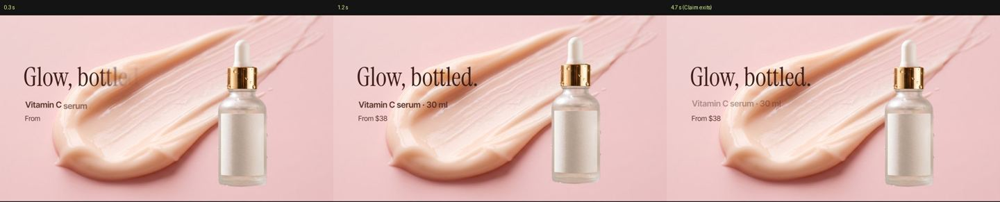

- **Worked:** headline in, claim in, claim out at 4.7 s.
- **Checked:** contrast over the texture. `check_layout` gave no warning, because the text sits on the light part.

## UC04 · Kitchen · Loops and transitions
**Brief:** a stand mixer launch: a whip-out from the kitchen photo, a push-in on the product, a float loop.

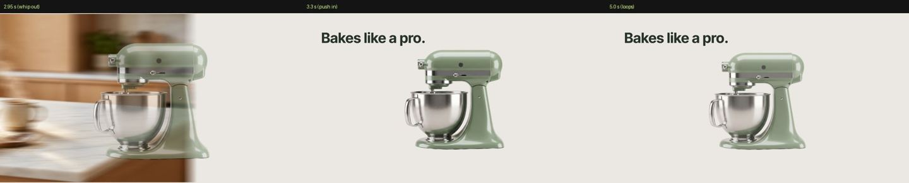

- **Worked:** Whip Pan out, Push Through in, Float on the product.
- **F3:** a transition only animated each layer on its own. The designer had to line up the exit of one layer and the
  entrance of the next by hand.
  **Fix:** select the two layers in Behaviors › Transitions and press **Transition**. The first one selected leaves
  while the second arrives, from the playhead.
  Also available as MCP `apply_transition`.

## UC05 · Cars · Curves
**Brief:** a spec reveal for the Vela One: a studio side shot with a slow push-in, and a spec card on the wall. The
client's file arrives with plain linear keys, and the note is "make it feel smoother, more premium".
**Steps:** select every layer, then Curves › S curve (1, 0, 0, 1) › Apply. No keyframes are selected, so it applies to
every key of those layers.

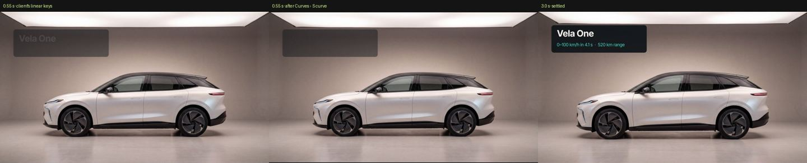

- **Worked:** "S curve on 7 keyframe pairs in 4 layers". The values stay; only the speed changes. At the same 0.55 s,
  the linear card has already half arrived, while the eased one is still waiting to glide in. The values read back
  exactly (100 % influence, speed 0).
- **Design note:** the first layout put the card over the front wheel, and a cut-out car on a road looked pasted. A
  full studio photo and a card on the empty wall read as one real piece.

## UC06 · Beauty · Brands (Lumé)
**Brief:** create the brand in its own folder, apply it, share it with a teammate, and merge their update.

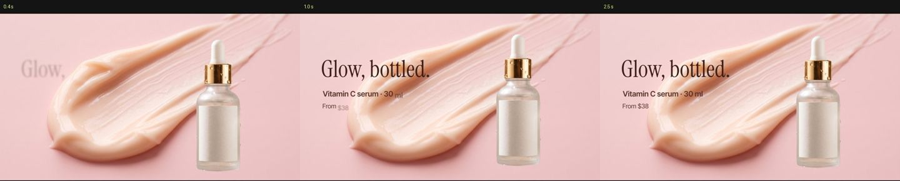

- **Worked:** create in an external folder, apply its style and curve, *Download to share*, *Import an update*.
  The rules merged: new, edited and removed.
- **F4:** `brand.py new` did not make the folder a Claude folder.
  **Fix:** it writes `CLAUDE.md` and `.mcp.json`, like the panel does.
- **F5:** messages did not tell "animated" apart from "redone".
  **Fix:** they do now.
- **F6:** the import printed "1 new rules".
  **Fix:** plurals are correct.

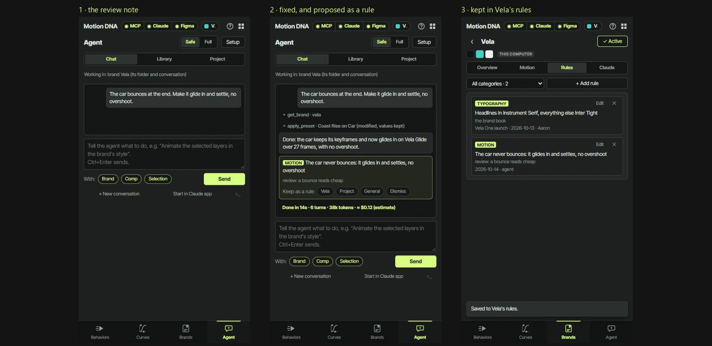
*The same flow in the panel (Vela demo): the note, the rule it proposes, the rule kept in the brand.*

- **UC06b, Agent:** a review note on the piece came back as two `RULE:` lines. The panel asked
  where to keep them instead of saving them on its own. 53 s, about USD 0.45.

## UC07 · Fashion · A style from the Agent's Library
**Brief:** Library › Styles › Editorial › *Use in chat*.

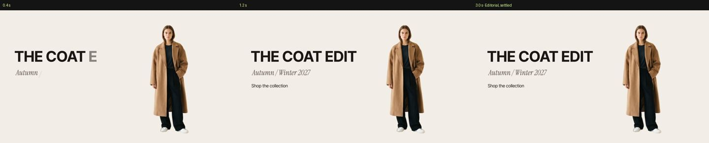

- **Worked:** 37 s, about USD 0.36.
- **F7:** the order said "the open comp (or the selected layers)", which is ambiguous.
  **Fix:** the order now says "the selected layers (every layer of the open comp if none are selected)", and the
  context says how many layers are selected.

## UC08 · Fashion · Text behind a person (Agent, Full mode)
**Brief:** "COAT" in huge letters behind the model.

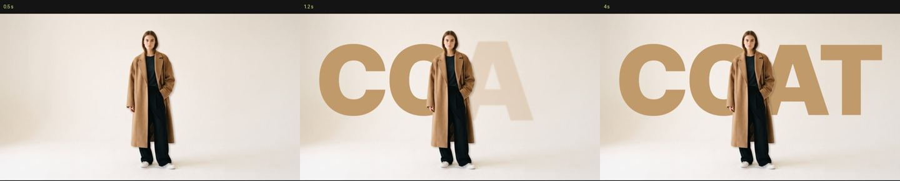

- **Worked, slowly:** 119 s, 34 turns, about USD 1.24.
- **F8:** the agent could not run the local matte, so it fell back to a rough GrabCut.
  **Fix:** the MCP tool `matte` (a still or a video, local GPU, no cost).
- **F9:** techniques had no tools, so the agent improvised.
  **Fix:** the MCP tool `text_behind` does it in one call, and each technique in `library/techniques.json` names its tool.
- **F10:** the agent saved the After Effects project without being asked.
  **Fix:** its context and the MCP instructions say never to save unless asked.
- **F11:** the "T" ran outside the safe area and nobody checked.
  **Fix:** the MCP tool `check_layout` runs before a build is called done.

## UC09 · Cars · Figma frame → After Effects (Agent, Full mode)
**Brief:** take the Figma frame *02 Specs* and rebuild it as editable layers, animated in Vela's style.

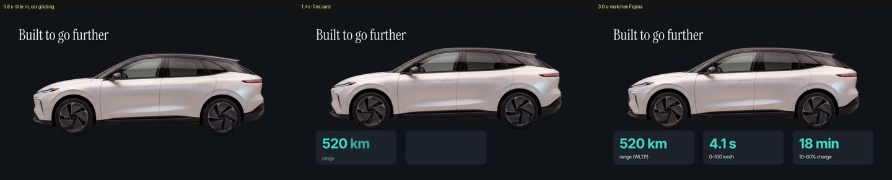

- **Worked:** native layers (a solid, the car cut-out, text in the brand fonts, rounded shape cards) placed as in Figma.
  191 s, 42 turns, about USD 1.99.
- **F12:** `apply_brand` used the style's default timing (a 700 ms car with overshoot), but Vela says 900 ms and no bounce.
  **Fix:** `SSP.brandTiming` applies the brand's own timing after the style.
- **F13:** after a retime, the marker expressions kept the old timing.
  **Fix:** `restyle` moves our marker expressions and the SS in / SS out markers too.
- **F14:** the comp was built in whichever project was open.
  **Fix:** the context names the project's own `.aep` and asks before building elsewhere.

## UC10 · Projects and conversations
- **Worked:** *Agent › Project › New project* made the folder tree, saved the open After Effects project in `05_ae`,
  and gave the project its own Claude conversation.
  *Open in Claude app* continued that same conversation in the Claude app.
- **Worked:** the cost of each order is logged to `<project>/claude/usage.csv`.

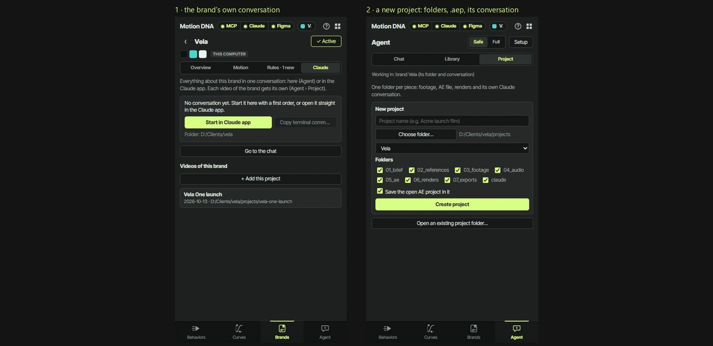
*Agent › Project and the brand's own conversation, as in the panel.*

## UC11 · MCP directly, plus layout QA
- **Worked:** `python tools/test_mcp.py` calls every tool the way Claude does: 27 of 27 calls passed, and no tool is
  left untested. `matte` and `text_behind` run on a product photo fixture (`research/tests/fixtures/`), and
  `add_brand_note` writes to a temporary brand. The test removes the brand, its registry entry and the imported files.
  `matte` and `text_behind` are reported as SKIP, not FAIL, on a machine without the local GPU matte.
- **`check_layout` on all nine comps:**
  - At first it raised four contrast warnings at 0 s. Three of them were false: it measured text that was still
    fading in, and text sitting on a shape card. It now judges contrast once the text has settled, and counts a shape
    card under the text as its plate.
  - One warning is real and stays: "COAT" in UC08, tan on cream, 1.6:1. That is a design choice the review should
    catch: use a darker tone or a shadow.

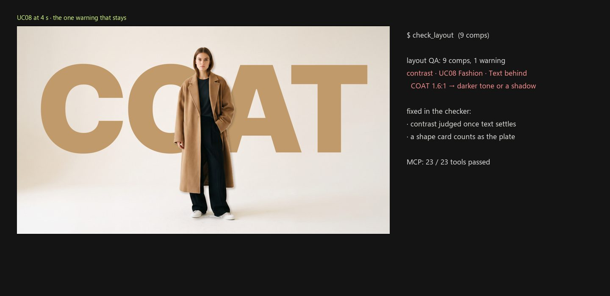

## UC12 · Cars · Tracked labels and HUD
**Brief:** a design-details shot of the Vela One: a slow handheld move on the wheel and the light bar, with callouts
that stick to them. The plate is a camera move made from a 4K still, at no generation cost.
**Steps:** `tools/track_points.py` on three regions (wheel, light bar, air intake), with confidence 0.93–1.0. Then a
scene spec for `tools/build_scene.jsx`: two callouts, a chip, a bracket and a kicker.

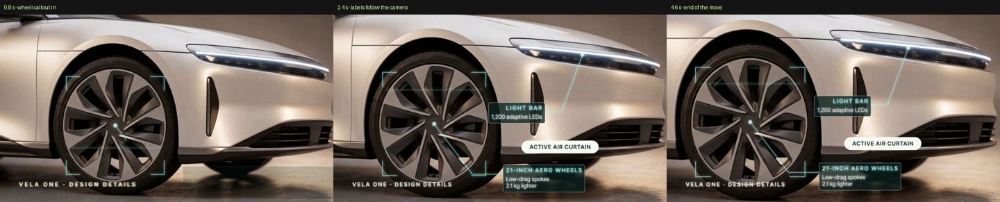

- **Worked:** the labels follow the camera for the whole move.
- **F18:** the wheel callout pointed outward, and the camera move pushed it out of frame.
  **Fix:** callouts on a moving shot point *inward* (rule 15 in CONTRIBUTING §9).
- **F19:** the HUD defaults were 18–26 px, below our own 32 px rule, and light text sat on white paint.
  `check_layout` caught both.
  **Fix:** the HUD defaults are now 32 px, and callouts use `"card": true` on light plates.

## UC13 · Cars · Speed ramp
**Brief:** the road shot rushes in, then lands in slow motion for the claim.
**Steps:** Behaviors › Moves › Speed Ramp on the footage layer, or MCP `apply_preset`.

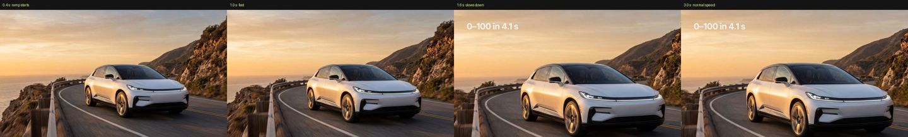

- **Worked:** time remap from 0 to 1.46 s of footage in the first second, 5.48 s by 2 s, then about 0.13× to the end.
- **Tip:** the ramp spends most of the clip in its first two seconds. Give it a plate at least 2.5 times longer than
  the rushed part.

## UC14 · Eyewear · The 9 styles on one real layout
**Brief:** the Oku Optics web hero (brand, eyebrow, a two-line serif title, price and a button), once per style.
**Steps:** Agent › Library › Styles, or MCP `apply_pack`, on nine copies.

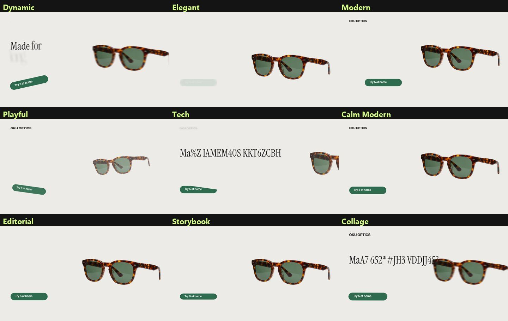
*At 0.4 s each style moves differently: whips, blurs, decoding text, a jack-in-the-box. By 3.5 s all nine land on the
same layout.*

- **F22:** the button's label was animated apart from its pill.
  **Fix:** a style now skips layers that have a parent. Parent the label to its button and it rides with it. The label
  also fades with the button: After Effects does not pass opacity from parent to child, so an expression links it.
- **F21:** Playful left the button rocking. That is its Swing loop, not a bug.
  **Tip:** on a call to action, remove the loop or pick a calmer style.

## UC15 · Fashion · Text behind a person in video, contour, roto breakdown
**Brief:** "COAT" behind the model while the camera moves, a contour drawn around her, and a 2×2 breakdown of how the
shot was made.
**Steps:**
1. MCP `matte` (video → ProRes 4444 with alpha, local GPU).
2. `tools/matte_contours.py`.
3. A scene spec with `matte`, a `behind` text and a `contour`.
4. `tools/build_breakdown.jsx`.

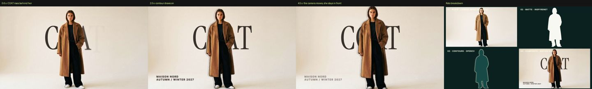

- **Worked:** she stays in front of the word for the whole move, with 0 layout warnings.
- **F23:** `build_scene.jsx` failed on a scene with no tracking file, although its header says `fps` is enough.
  **Fix:** without a tracking file, the plate gives the size and frame rate.
- **Design fixes:**
  - The kicker ran into her legs, so it is now two lines (rule 15).
  - A light contour vanished on the cream wall, so it is now ink.
  - COAT is dark brown this time, not UC08's tan.

## UC16 · Fashion · Freeze frame and kinetic type
**Brief:** the shot freezes, the background drains to pine while the model stays in colour, and a title lands.
**Steps:** an edit spec for `tools/build_edit.jsx` with a `freeze` (`mono`, the matte and the plate) and a `split`
title.

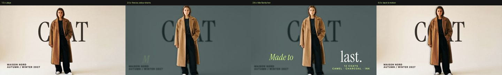

- **Worked:** freeze, colour drain, kinetic title, and back to motion.
- **Design fixes:** it took three passes, each caught by eye or by `check_layout`:
  1. The default centred title sat on her body.
  2. Split around her ("Made to" in the italic serif, "last." large), it crossed the frozen COAT.
  3. Moved down into the empty space, the subtitle left the frame, so it now breaks into two lines.

## UC17 · Kitchen · Shape wipe
**Brief:** a sage wipe carries the kitchen scene into the product shot.
**Steps:** a full-frame solid with Color Wipe in and out around the cut, then the new scene's title.

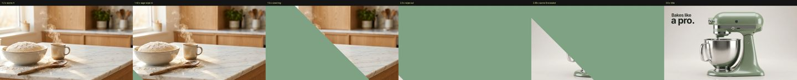

- **Worked:** the diagonal sweep covers the cut and reveals the mixer.
- **F20:** the one-line title ran into the mixer. `check_layout` cannot see products, only faces.
  **Fix:** a new rule (rule 15 in CONTRIBUTING §9): break the title and play with sizes ("Bakes like" at 64 px over
  "a pro." at 132 px).

## UC18 · Beauty · Marker timing
**Brief:** the client wants the headline to land a second later.
**Steps:** apply with *Marker timing*, then drag the `SS in` marker 1 s later. No keyframe is touched.

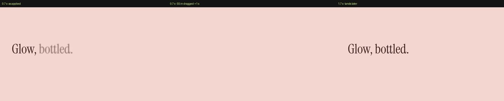

- **Worked:** at 0.7 s the retimed headline has not started yet; at 1.7 s it has landed.

## UC19 · Cars · Cut on the voice
**Brief:** four shots for a four-line voiceover, each cut where its phrase starts.
**Steps:** a free local voice (Windows speech), `tools/vo_words.py` (Whisper) for the word times, and cuts two frames
before each phrase.

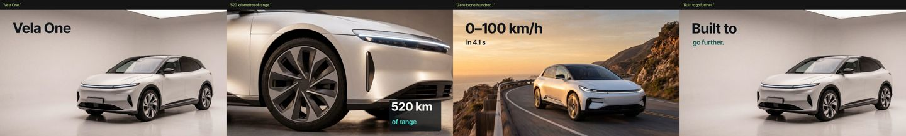

- **Worked:** cuts at 0, 2.18, 5.40 and 9.30 s.
- **Tip:** Whisper heard "Vila" for Vela. Check brand names in the transcript before you cut on them.
- **Found and fixed in `check_layout`:** it counted any drop shadow as help, even a faint one. Now only a shadow of
  60 % opacity or more counts.
- **What it then caught, now fixed:** white text on the white studio, text touching the car, and a card over the
  wheel. Each shot now places its text in its own empty area, in the ink that reads there.

## UC20 · Eyewear · A brand that learns
**Brief:** start Oku Optics with the wrong guess (Dynamic), then give two review notes and watch the brand adapt.

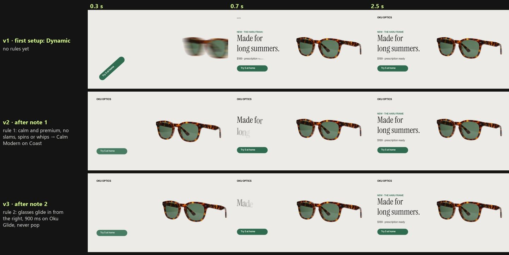

1. **v1:** `apply_brand oku` with no rules. It feels like a sneaker drop: whips and a spinning button.
2. **Note 1 → rule 1 (motion):** "Eyewear moves calm and premium: soft rises, word-by-word text, no slams, spins or
   whips." The feel becomes Calm Modern on Coast. **v2:** soft rises and words fading up.
3. **Note 2 → rule 2 (motion):** "The glasses glide in from the right and settle in 900 ms on Oku Glide: never pop,
   never bounce." The brand gets its own curve (Oku Glide) and a timing entry. **v3:** `apply_brand` retimes the glasses
   and the title on Oku Glide by itself. Following the rule, the agent swaps the rise for Glide In, mirrored so it
   comes from the right.

The brand file now holds both rules, the curve and the timing, so the next piece for Oku starts from v3.
- **F24:** `brand.py show` printed a single preferred preset letter by letter.
  **Fix:** a single name is accepted.

## Locations for the video: one set, not twelve
The office views for the video were generated separately and did not agree with each other. Some had a window, a plant
and a water cooler that the wide shot does not have; one had a white open door; another had the desks side by side.

**Fix:** we took `office_wide` as the reference image and regenerated four views from it: the reverse angle, both desk
close-ups and the floor plan (Nano Banana 2.1 image-to-image, 2 variants each, USD 0.632). For each view we kept the
more coherent variant: same walnut walls, same closed door in the middle of the back wall, same furniture.

**Second pass:** even views generated from the master moved the screens and swapped the desk props. So the desk
close-ups are now crops of the master upscaled on the local GPU (`tools/upscale_crop.py`, free), and the floor plan is
drawn from it. Only the reverse angle is generated: the master and both close-ups were the references, the result was
mirrored so each desk's props sit on the right side, and the side desks were edited out, since they stand behind the
camera in that view (USD 0.316 more).

**The rule for any set:** pick one master frame. Crop it for close-ups, draw the plan from it, and generate only the
angles it cannot show, with it as the reference. Then check every view, object by object, against the master.

## Panel reviews
- **F15:** a style without its preview showed a broken image.
  **Fix:** the panel shows a placeholder, and `tools/check_previews.py` (run by setup and the tests) lists what is
  missing.
- **F16:** "Copy resume command" overflowed its button.
  **Fix:** it is now a compact `>_` button.
- **F17** (Gian): the chat had a big empty box you could not type in.
  **Fix:** the order field is now the main element, and the conversation appears with the first order.
- **Narrow docks:** every section was checked at 230, 300 and 420 px; nothing overflows.
- **The panel kept old screens after a push:** the signed install is now a shell that loads the code from the clone.
